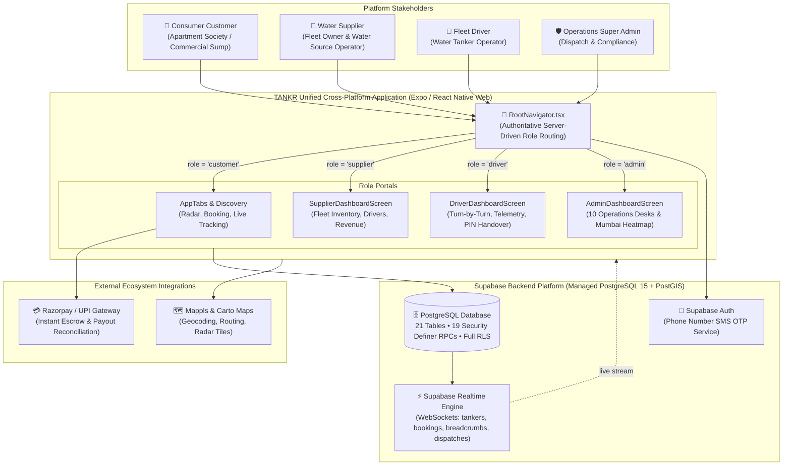

# TANKR 💧

> **Water delivery, just a tap away.**

[](https://expo.dev/)
[](https://reactnative.dev/)
[](https://react.dev/)
[](https://www.typescriptlang.org/)
[](https://supabase.com/)
[](https://postgis.net/)
[](https://github.com/pmndrs/zustand)
[](https://jestjs.io/)
[](LICENSE)

---

## 📖 Table of Contents

- [1. Introduction & Mission](#1-introduction--mission)
- [2. System Architecture](#2-system-architecture)
- [3. Platform Roles & User Experiences](#3-platform-roles--user-experiences)
- [4. Operational Features & Verification Status](#4-operational-features--verification-status)
- [5. Technology Stack](#5-technology-stack)
- [6. Prerequisites](#6-prerequisites)
- [7. Automated Quick Start (One-Command Setup)](#7-automated-quick-start-one-command-setup)
- [8. Genuine Local Demo Credentials](#8-genuine-local-demo-credentials)
- [9. Environment Configuration](#9-environment-configuration)
- [10. Testing & Verification Gates](#10-testing--verification-gates)
- [11. Operations Command Admin Portal (10 Desks)](#11-operations-command-admin-portal-10-desks)
- [12. Deployment](#12-deployment)
- [13. Contributing & Code of Conduct](#13-contributing--code-of-conduct)
- [14. Security Policy](#14-security-policy)
- [15. Troubleshooting](#15-troubleshooting)
- [16. Complete Documentation Index](#16-complete-documentation-index)

---

## 1. Introduction & Mission

**TANKR** is an on-demand, geospatial water logistics and deficit dispatch platform engineered to solve urban water insecurity across high-deficit metropolitan areas (specifically calibrated for Mumbai Metro — Marol, Sakinaka, SEEPZ, Powai, Chakala, and Chandivali).

### The Problem It Solves:
In expanding metropolitan centers, municipal piped infrastructure frequently experiences low-pressure deficits, contamination shutdowns, or sudden main bursts. Residential apartment societies, commercial complexes, and healthcare facilities (dialysis centers and ICUs) rely on unorganized, opaque private water tankers plagued by predatory surge pricing, delivery delays, unverified water purity, and lack of accountability.

### How TANKR Works:
1. **Consumer Discovery & Sump Pinpointing**: Customers drop a pin on their building sump, select required water capacity (2,000L to 20,000L) and grade (Potable BIS 10500, Filtered Borewell, or Construction Utility), and receive an atomic 15-minute guaranteed price quote.
2. **Guaranteed Anti-Double-Booking**: PostgreSQL row-level locks prevent concurrent order placement on the same physical vehicle.
3. **Live Telemetry & Handover Verification**: High-frequency GPS tracking streams vehicle progress. Upon arrival, the driver cannot open the valve or mark delivery complete without entering the customer's secure 4-digit PIN and verifying volume with a calibrated digital flow meter.
4. **Automated Escrow & Regulatory Compliance**: Payments are held in escrow and disbursed automatically (85% driver, 5% vehicle maintenance, 10% platform fee), while water sources undergo automated BIS 10500 laboratory sensor surveillance.

---

## 2. System Architecture



For complete technical specifications, see:
- [System Architecture Specification](docs/architecture/ARCHITECTURE.md)
- [Database ER Diagram & 21-Table Schema](docs/architecture/DATABASE_ARCHITECTURE.md)
- [Booking State Machine Lifecycle](docs/architecture/BOOKING_LIFECYCLE.md)

---

## 3. Platform Roles & User Experiences

TANKR strictly avoids client-side role switching. The authenticated user profile row in `public.profiles` dictates what interface is rendered by [`RootNavigator.tsx`](src/navigation/RootNavigator.tsx):

| Role | Target Screen | Operational Scope |
| :--- | :--- | :--- |
| **`customer`** | [`AppTabs.tsx`](src/navigation/AppTabs.tsx) | Sump pinpointing, nearby tanker radar, atomic checkout, live GPS tracking, 4-digit PIN verification, GST invoice receipt. |
| **`supplier`** | [`SupplierDashboardScreen.tsx`](src/features/supply/screens/SupplierDashboardScreen.tsx) | Fleet status monitoring, tanker onboarding (license, capacity, source), driver assignment, revenue tracking. |
| **`driver`** | [`DriverDashboardScreen.tsx`](src/features/supply/screens/DriverDashboardScreen.tsx) | GPS telemetry transmission (foreground/background task), turn-by-turn route guidance, flow meter drop confirmation. |
| **`admin`** | [`AdminDashboardScreen.tsx`](src/features/admin/screens/AdminDashboardScreen.tsx) | 10 live operational desks: Mumbai fleet map, hospital emergency dispatches, driver payouts, lab audits, disputes, service zones. |

---

## 4. Operational Features & Verification Status

| Feature Domain | Operational Capability | Implementation Status |
| :--- | :--- | :---: |
| **Authentication** | Passwordless SMS OTP authentication backed by Supabase Auth and test credentials | **VERIFIED WORKING** |
| **Onboarding** | Profile setup, sump location geocoding, and default address storage | **VERIFIED WORKING** |
| **Discovery** | PostGIS spatial queries locating nearest available tankers by capacity and grade | **VERIFIED WORKING** |
| **Quoting Engine** | 15m binding price quotes (`calculate_booking_quote`) with dynamic surge multipliers | **VERIFIED WORKING** |
| **Concurrency Lock**| Row-level `FOR UPDATE` vehicle locking preventing double bookings | **VERIFIED WORKING** |
| **Tracking** | Real-time GPS breadcrumb streaming over Supabase WebSocket CDC | **VERIFIED WORKING** |
| **Handover** | 4-digit customer PIN verification required for delivery completion | **VERIFIED WORKING** |
| **Escrow & Payouts**| Automated 85/5/10 earnings breakdown, driver ledger, and batch settlement | **VERIFIED WORKING** |
| **Fleet Radar Map** | Anti-collision Fermat spiral dispersion, perimeter zone badges, live vehicle CRUD | **VERIFIED WORKING** |
| **Emergency SLA** | 20-minute priority override dispatch for hospitals and critical care units | **VERIFIED WORKING** |
| **Lab Safety Audit** | Bureau of Indian Standards (BIS 10500) compliance monitoring (TDS < 250 ppm) | **VERIFIED WORKING** |
| **Hardware Sensors** | Digital flow meter calibration reading (simulated BLE sensor payload) | **PARTIALLY IMPLEMENTED** |

See [Features Catalog](docs/project/FEATURES.md) for the complete capability matrix.

---

## 5. Technology Stack

### Frontend & Client Applications
- **Core Framework**: [React Native 0.88.1](https://reactnative.dev/) with [React 19.3.0](https://react.dev/)
- **Application Tooling**: [Expo SDK 58.0.21](https://expo.dev/) with [Expo Router pattern](https://docs.expo.dev/router/introduction/)
- **Web Support**: [react-native-web 0.21.4](https://necolas.github.io/react-native-web/)
- **State Management**: [Zustand 5.0.16](https://github.com/pmndrs/zustand)
- **Data Validation**: [Zod 4.6.7](https://zod.dev/)
- **Sensors & Hardware**: `expo-location 58.0.20`, `expo-task-manager 58.0.12`, `expo-secure-store 58.0.2`
- **Iconography & Theming**: `@expo/vector-icons 15.0.2` (Ionicons)

### Backend, Database & Cloud
- **Database**: [PostgreSQL 15](https://www.postgresql.org/) with [PostGIS Spatial Extension](https://postgis.net/)
- **Backend as a Service**: [Supabase](https://supabase.com/) (`@supabase/supabase-js 2.118.0`)
- **Authentication**: Supabase Auth (SMS OTP with `[auth.sms.test_otp]`)
- **Real-Time Engine**: Supabase Realtime (Phoenix / Elixir WebSockets CDC)

### Third-Party Services
- **Mapping & Geocoding**: [Mappls / MapmyIndia](https://about.mappls.com/) & [Carto Basemaps](https://carto.com/)
- **Payment Processing**: [Razorpay Payment Gateway](https://razorpay.com/) (Test sandbox & live webhook escrow)

### Quality Assurance & Tooling
- **Testing Engine**: [Jest 30.5.2](https://jestjs.io/) with [ts-jest 29.4.15](https://kulshekhar.github.io/ts-jest/)
- **Static Typing**: [TypeScript 6.0.3](https://www.typescriptlang.org/) (Strict mode enabled)

---

## 6. Prerequisites

Before setting up TANKR, ensure your host machine has:
- **Node.js**: `>= v18.0.0` (Node.js `v20+` LTS recommended). Run `node -v` to check.
- **npm**: `>= v9.0.0` or `v10+`. Run `npm -v` to check.
- **Git**: `>= v2.30.0`. Run `git --version` to check.
- **Docker Engine** *(Optional)*: Required only if running the local Supabase container stack.
- **Supabase CLI** *(Optional)*: Available globally or automatically via `npx supabase`.

---

## 7. Automated Quick Start (One-Command Setup)

To bootstrap your development environment in a single command:

```bash
# 1. Clone repository
git clone https://github.com/Coderaryanyadav/Tankr.git
cd Tankr

# 2. Make automation scripts executable
chmod +x scripts/*.sh

# 3. Run automated one-command setup
./scripts/setup.sh
```

### What `./scripts/setup.sh` Automates:
1. Verifies host OS, architecture, Node version, and required tools.
2. Generates `.env` from template if missing.
3. Installs exact dependencies using `npm install`.
4. Runs `./scripts/validate-env.sh` to check configuration validity without leaking secrets.
5. Runs static type compilation (`npx tsc --noEmit`) to verify 0 errors.
6. Executes all 28 automated unit and regression tests.
7. Prints copy-paste launch commands and demo login accounts.

### Launching the Application:
```bash
./scripts/start-dev.sh web       # Opens in Web Browser at http://localhost:8081
./scripts/start-dev.sh ios       # Launches in iOS Simulator
./scripts/start-dev.sh android   # Launches in Android Emulator
```

---

## 8. Genuine Local Demo Credentials

TANKR includes genuine local demo accounts configured with fixed test OTP **`123456`**. These accounts authenticate directly against Supabase and load their verified database roles:

| Persona | Mobile Number (10 digits) | Fixed OTP | Target Portal | Test Data & Assigned Fleet |
| :--- | :--- | :---: | :--- | :--- |
| **Super Admin** | `8888888888` | `123456` | **Operations Command** | Full access to all 10 desks, live Mumbai fleet map, and CRUD actions. |
| **Water Supplier** | `9999999999` | `123456` | **Supplier Dashboard** | Marol Potable Water Hub, fleet size: 6 tankers, revenue overview. |
| **Fleet Driver** | `9000000001` | `123456` | **Driver Console** | Driver: Rajesh Sharma, assigned tanker: `MH-02-TC-5001` (5,000L). |
| **Consumer Customer** | `9876543210` | `123456` | **Customer App** | Vikram Malhotra, saved address: Ruby Apts, Marol, Mumbai. |

> [!NOTE]
> Enter the 10-digit number on the login screen. On the verification screen, enter `123456`. You will be instantly authenticated and routed to the corresponding role dashboard.

---

## 9. Environment Configuration

TANKR uses a single `.env` file at the repository root. Copy the template:

```bash
cp .env.example .env
```

### Key Variables:
```env
# Supabase Backend (Required)
EXPO_PUBLIC_SUPABASE_URL=https://your-project.supabase.co
EXPO_PUBLIC_SUPABASE_ANON_KEY=your-publishable-anon-key

# Payment Gateway (Optional Sandbox)
EXPO_PUBLIC_RAZORPAY_KEY_ID=rzp_test_your_key_id

# Maps & Geospatial (Optional Fallback to OpenStreetMap)
EXPO_PUBLIC_MAPPLS_REST_KEY=your_mappls_api_key
EXPO_PUBLIC_CARTO_API_KEY=your_carto_key
```

Validate your configuration safely at any time:
```bash
./scripts/validate-env.sh
```

See [Environment Setup Guide](docs/setup/ENVIRONMENT_SETUP.md) for full details.

---

## 10. Testing & Verification Gates

TANKR adheres to rigorous quality assurance standards. Run the following verification commands:

```bash
# 1. Static Typecheck (Strict TypeScript 6.0)
npm run typecheck

# 2. Automated Jest Test Suite (28 unit and regression tests)
npm run test:ci

# 3. Complete Pre-Release Verification Gate (Types, Tests, Schema, Secrets)
./scripts/verify-project.sh
```

---

## 11. Operations Command Admin Portal (10 Desks)

The Administrator Command Portal (`role = 'admin'`) provides 10 dedicated operational desks with live CRUD mutations:

```text
Admin Operations Command
├── 1. Operations Desk            -> Live GMV, revenue, delivery rates, dynamic surge multiplier
├── 2. Fleet Map & Heatmap       -> Anti-collision radar dispersion, live telemetry, tanker CRUD
├── 3. Hospital Dispatch (20m)   -> Priority emergency routing for dialysis units & ICUs
├── 4. Financial & Payouts       -> 85/5/10 fee split, driver ledger inspection, batch settlement
├── 5. Water Quality Audit Desk  -> Sensor tracking for TDS (<250 ppm), pH, and lab certificates
├── 6. Corporate Contracts Desk  -> Commercial B2B recurring delivery agreements and volume SLAs
├── 7. Supplier KYC Approvals    -> Vendor verification queue with approve/reject actions
├── 8. Disputes & Escrow Desk    -> Customer arbitration, evidence inspection, atomic refunds
├── 9. PostGIS Service Zones     -> Spatial zone boundaries, minimum fleet density, liquidity
└── 10. System Audit Trail       -> Real-time immutable event log of administrative actions
```

---

## 12. Deployment

- **Web Deployment**: Build the web static distribution via `npx expo export --platform web`. Output in `dist/` can be deployed to Vercel, Netlify, or Cloudflare Pages.
- **Mobile Builds**: Distributed via EAS (Expo Application Services) to Google Play Store and Apple App Store (`eas build --profile production`).
- **Database Migrations**: Applied forward via `./scripts/run-migrations.sh` or through the Supabase Cloud SQL Editor.

See [Production Deployment Guide](docs/deployment/DEPLOYMENT.md) and [Production Checklist](docs/deployment/PRODUCTION_CHECKLIST.md).

---

## 13. Contributing & Code of Conduct

We welcome contributions! Please review our [Contributing Guide](CONTRIBUTING.md) and [Code of Conduct](CODE_OF_CONDUCT.md).

Before opening a pull request, ensure:
1. `npm run typecheck` passes with **0 errors**.
2. `npm run test:ci` passes all test suites.
3. `./scripts/verify-project.sh` passes all 6 verification gates.

---

## 14. Security Policy

Security reports are taken with utmost seriousness. Please report vulnerabilities to **`security@tankr.in`**. Do not open public GitHub issues for security matters. Review our [Security Policy](SECURITY.md) for details on responsible disclosure.

---

## 15. Troubleshooting

If you encounter issues during installation or runtime:
- **`permission denied for table profiles`**: Ensure the master migration [`supabase/migrations/20261031000001_master_database_schema.sql`](supabase/migrations/20261031000001_master_database_schema.sql) has been applied in your Supabase SQL Editor (it includes table grants and `complete_customer_onboarding`).
- **Port 8081 already in use**: Run `./scripts/clean.sh` to clear stale Metro processes.
- **Missing environment variables**: Run `./scripts/validate-env.sh`.

See [Troubleshooting Guide](docs/setup/TROUBLESHOOTING.md) for detailed diagnostics and solutions.

---

## 16. Complete Documentation Index

| Guide | Description |
| :--- | :--- |
| [Architecture Reference](docs/architecture/ARCHITECTURE.md) | Foundational design principles and high-level structure. |
| [System Overview](docs/architecture/SYSTEM_OVERVIEW.md) | Comprehensive functional breakdown across all 4 personas. |
| [Frontend Architecture](docs/architecture/FRONTEND_ARCHITECTURE.md) | Component hierarchy, design tokens, and state management. |
| [Backend Architecture](docs/architecture/BACKEND_ARCHITECTURE.md) | Supabase integration, 19 stored procedures, and triggers. |
| [Database Architecture](docs/architecture/DATABASE_ARCHITECTURE.md) | 21-table schema, PostGIS spatial indexing, and constraints. |
| [Installation Guide](docs/setup/INSTALLATION.md) | Automated one-command setup and manual installation. |
| [Environment Setup](docs/setup/ENVIRONMENT_SETUP.md) | Environment variables catalog and security guidelines. |
| [Database Setup](docs/setup/DATABASE_SETUP.md) | PostgreSQL 15, PostGIS extension, and migration instructions. |
| [API Reference](docs/api/API_REFERENCE.md) | Client Zustand store interfaces and action signatures. |
| [Database Functions](docs/api/DATABASE_FUNCTIONS.md) | Exhaustive documentation for all 19 PostgreSQL RPCs. |
| [Testing Architecture](docs/development/TESTING.md) | Jest test catalog and regression testing. |
| [Features & Roadmap](docs/project/FEATURES.md) | Implementation status and upcoming engineering milestones. |

---

<p align="center">
  <b>TANKR</b> — Engineered for Urban Water Resilience 💧
</p>
