<div align="center">

# 💧 TANKR

### _Urban Water Deficit Logistics, Emergency Dispatch & Fair Metering Platform_

<p align="center">
  <i>Mission-critical water logistics for high-density metropolitan ecosystems — calibrated for Mumbai Metro.</i>
</p>

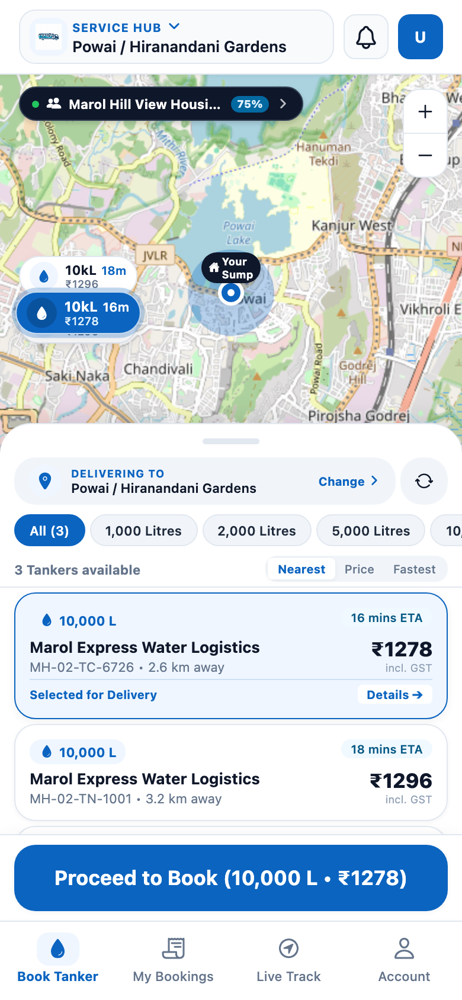

<br/>

[](https://expo.dev/)
[](https://reactnative.dev/)
[](https://www.typescriptlang.org/)
[](https://supabase.com/)
[](https://postgis.net/)
[](https://razorpay.com/)
[](https://github.com/Coderaryanyadav/Tankr/actions/workflows/ci.yml)
[](#11-testing--verification-gates)

<br/>

**[📱 Visual Showcase](#-executive-visual-showcase)** &nbsp;•&nbsp;
**[📐 Architecture](#2-system-architecture--documented-technical-diagrams)**
&nbsp;•&nbsp; **[🚀 Quick Start](#8-automated-quick-start-one-command-setup)**
&nbsp;•&nbsp; **[🔑 Demo Credentials](#9-genuine-local-demo-credentials)**
&nbsp;•&nbsp; **[🧪 Test Gates](#11-testing--verification-gates)** &nbsp;•&nbsp;
**[🤝 Contributing](./CONTRIBUTING.md)**

</div>

---

## 📱 Executive Visual Showcase

<table align="center">
  <tr>
    <td align="center" width="25%">
      <b>1. Consumer Discovery</b><br/>
      <br/>
      <i>Radar & Sump Pinpointing</i>
    </td>
    <td align="center" width="25%">
      <b>2. Live Telemetry</b><br/>
      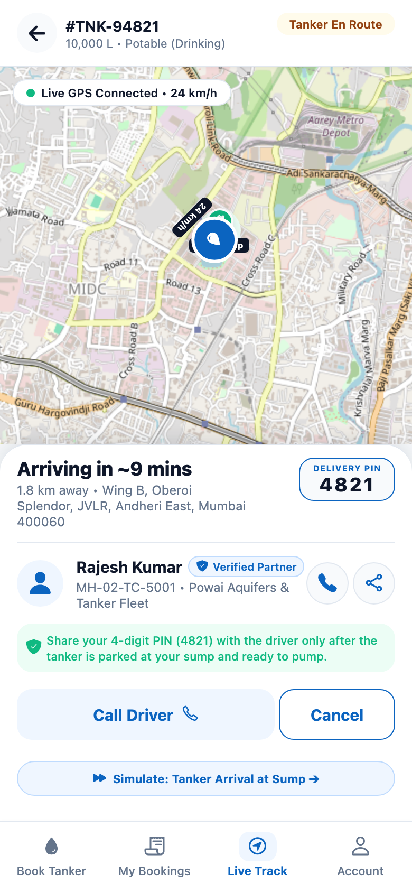<br/>
      <i>Real-Time GPS Tracking</i>
    </td>
    <td align="center" width="25%">
      <b>3. Driver Console</b><br/>
      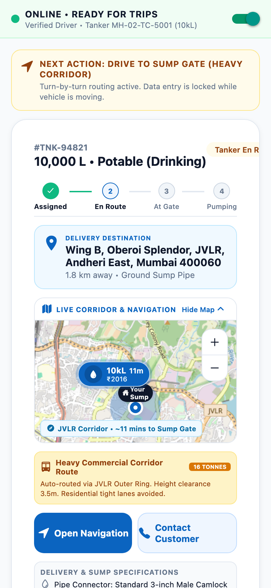<br/>
      <i>Turn-by-Turn & 4-Digit PIN</i>
    </td>
    <td align="center" width="25%">
      <b>4. Admin Operations</b><br/>
      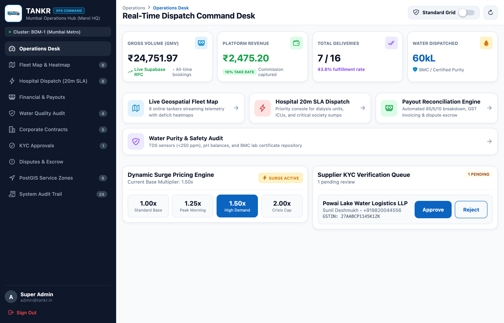<br/>
      <i>10 Live Desks & Fleet Heatmap</i>
    </td>
  </tr>
</table>

> 💡 **Explore the complete interactive gallery:** Open
> [`docs/screenshots/index.html`](docs/screenshots/index.html) in any browser to
> inspect all 33 production screen captures cross-referenced by role.

---

## 📖 Table of Contents

- [1. Introduction & Mission](#1-introduction--mission)
- [2. System Architecture & Documented Technical Diagrams](#2-system-architecture--documented-technical-diagrams)
  - [2.1 End-to-End System Architecture & Data Plane](#21-end-to-end-system-architecture--data-plane)
  - [2.2 Booking & Dispatch State Machine](#22-booking--dispatch-state-machine)
  - [2.3 Real-Time GPS Telemetry & PostGIS Breadcrumb Ingestion](#23-real-time-gps-telemetry--postgis-breadcrumb-ingestion)
  - [2.4 Razorpay Escrow, GST Invoicing & Automated Payout Splits (85/5/10)](#24-razorpay-escrow-gst-invoicing--automated-payout-splits-85510)
  - [2.5 Operations Command 10-Desk Hierarchy & Emergency Override Dispatch Flow](#25-operations-command-10-desk-hierarchy--emergency-override-dispatch-flow)
- [3. Comprehensive Screenshot Gallery (33 Production Screens)](#3-comprehensive-screenshot-gallery-33-production-screens)
  - [3.1 Consumer Mobile Application Experience](#31-consumer-mobile-application-experience)
  - [3.2 Fleet Driver Navigation & Delivery Handover](#32-fleet-driver-navigation--delivery-handover)
  - [3.3 Water Supplier Management Portal](#33-water-supplier-management-portal)
  - [3.4 Operations Super Admin Portal (10 Live Desks)](#34-operations-super-admin-portal-10-live-desks)
  - [3.5 Antigravity Design System Showcase](#35-antigravity-design-system-showcase)
- [4. Platform Roles & User Experiences](#4-platform-roles--user-experiences)
- [5. Operational Features & Verification Status](#5-operational-features--verification-status)
- [6. Technology Stack](#6-technology-stack)
- [7. Prerequisites](#7-prerequisites)
- [8. Automated Quick Start (One-Command Setup)](#8-automated-quick-start-one-command-setup)
- [9. Genuine Local Demo Credentials](#9-genuine-local-demo-credentials)
- [10. Environment Configuration](#10-environment-configuration)
- [11. Testing & Verification Gates](#11-testing--verification-gates)
- [12. Operations Command Admin Portal (10 Desks)](#12-operations-command-admin-portal-10-desks)
- [13. Deployment](#13-deployment)
- [14. Contributing & Code of Conduct](#14-contributing--code-of-conduct)
- [15. Security Policy](#15-security-policy)
- [16. Troubleshooting](#16-troubleshooting)
- [17. Complete Documentation Index](#17-complete-documentation-index)

---

## 1. Introduction & Mission

**TANKR** is an on-demand, geospatial water logistics and deficit dispatch
platform engineered to solve urban water insecurity across high-deficit
metropolitan areas (specifically calibrated for Mumbai Metro — Marol, Sakinaka,
SEEPZ, Powai, Chakala, and Chandivali).

### The Problem It Solves:

In expanding metropolitan centers, municipal piped infrastructure frequently
experiences low-pressure deficits, contamination shutdowns, or sudden main
bursts. Residential apartment societies, commercial complexes, and healthcare
facilities (dialysis centers and ICUs) rely on unorganized, opaque private water
tankers plagued by predatory surge pricing, delivery delays, unverified water
purity, and lack of accountability.

### How TANKR Works:

1. **Consumer Discovery & Sump Pinpointing**: Customers drop a pin on their
   building sump, select required water capacity (2,000L to 20,000L) and grade
   (Potable BIS 10500, Filtered Borewell, or Construction Utility), and receive
   an atomic 15-minute guaranteed price quote.
2. **Guaranteed Anti-Double-Booking**: PostgreSQL row-level locks
   (`SELECT ... FOR UPDATE`) prevent concurrent order placement on the same
   physical vehicle.
3. **Live Telemetry & Handover Verification**: High-frequency GPS tracking
   streams vehicle progress. Upon arrival, the driver cannot open the valve or
   mark delivery complete without entering the customer's secure 4-digit PIN and
   verifying volume with a calibrated digital flow meter.
4. **Automated Escrow & Regulatory Compliance**: Payments are held in escrow and
   disbursed automatically (85% driver, 5% vehicle maintenance, 10% platform
   fee), while water sources undergo automated BIS 10500 laboratory sensor
   surveillance.

### ✨ Key Capabilities

- 📍 **Consumer Sump Geocoding**: High-precision interactive map pinpointing
  residential building sumps, overhead tanks, and commercial reservoirs.
- ⚡ **Atomic Anti-Double-Booking**: PostgreSQL concurrency engine with strict
  row-level locking (`SELECT ... FOR UPDATE`) eliminating race conditions across
  fleet assets.
- 📡 **Live Telemetry & Geofencing**: Real-time GPS breadcrumb ingestion via
  Supabase WebSocket pub/sub with dynamic arrival ETA calculations.
- 🔢 **Cryptographic 4-Digit PIN Handover**: Strict two-party delivery
  verification protocol preventing fraudulent discharges or delivery
  misreporting.
- 💳 **Escrow Split Engine**: Automated Razorpay payment splitting (85% Driver,
  5% Maintenance, 10% Platform) executing upon cryptographic handover.
- 🏢 **Operations Command (10 Desks)**: Super admin portal with 10 real-time
  operations desks, SOS emergency override dispatch, fleet heatmaps, and BIS
  10500 water quality auditing.
- 🧪 **Enterprise Test Coverage**: 240 unit & integration tests passing (0
  failures), strict TypeScript 6.0, and PostGIS geospatial validation.

---

## 2. System Architecture & Documented Technical Diagrams

### 2.1 End-to-End System Architecture & Data Plane

The following diagram illustrates the complete architectural boundary, from
multi-role clients to the server-driven role routing layer, PostgreSQL stored
procedures, PostGIS geospatial indexes, Supabase Realtime WebSocket engine, and
external integrations:

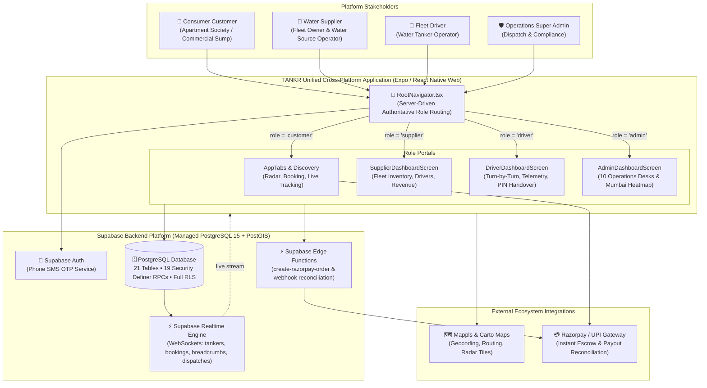

---

### 2.2 Booking & Dispatch State Machine

TANKR enforces strict atomic lifecycle state transitions. A booking cannot skip
intermediate milestones, nor can a vehicle be assigned concurrently to multiple
requests:

```mermaid
stateDiagram-v2
    [*] --> QuoteGenerated: Customer selects capacity (2k/5k/10k/20k) & Sump Location
    
    QuoteGenerated --> BookingRequested: Customer Confirms (create_booking_atomic)
    QuoteGenerated --> QuoteExpired: 15-minute TTL elapsed without confirmation
    
    BookingRequested --> Accepted: Supplier or Auto-Dispatch Engine Accepts
    BookingRequested --> CancelledByCustomer: Customer cancels before driver assignment
    BookingRequested --> AutoCancelledNoSupply: No tanker available within SLA window

    Accepted --> DriverAssigned: Supplier designates driver & tanker
    
    DriverAssigned --> EnRoute: Driver accepts order & begins trip
    
    EnRoute --> Arrived: Driver reaches sump GPS perimeter
    
    Arrived --> Dispensing: Delivery PIN verified (4-digit customer code entered)
    
    Dispensing --> Delivered: Flow meter confirms volume (driver_complete_delivery_with_meter)
    
    Delivered --> Settled: Funds released from escrow; driver payout credited (85%)
    Delivered --> Disputed: Customer contests volume, quality or contamination
    
    Disputed --> ResolvedRefund: Admin issues full or partial refund
    Disputed --> ResolvedDismissed: Admin validates sensor logs and dismisses dispute

    CancelledByCustomer --> [*]
    AutoCancelledNoSupply --> [*]
    QuoteExpired --> [*]
    Settled --> [*]
    ResolvedRefund --> [*]
    ResolvedDismissed --> [*]
```

---

### 2.3 Real-Time GPS Telemetry & PostGIS Breadcrumb Ingestion

High-frequency location pings from the driver console stream through background
tasks, PostGIS spatial coordinates, and Supabase WebSockets to render smooth
interpolations on the customer tracking map:

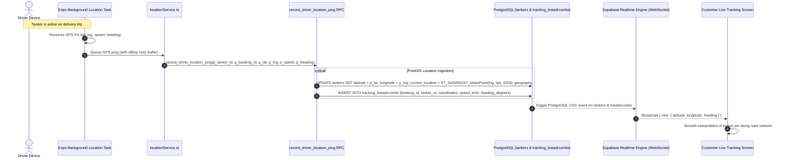

---

### 2.4 Razorpay Escrow, GST Invoicing & Automated Payout Splits (85/5/10)

Payments are securely verified and split into transparent ledger entries upon
atomic completion:

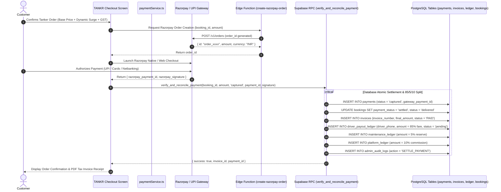

---

### 2.5 Operations Command 10-Desk Hierarchy & Emergency Override Dispatch Flow

The Super Administrator Command Portal coordinates metropolitan water supplies,
dynamic pricing multipliers, emergency hospital overrides, and regulatory
audits:

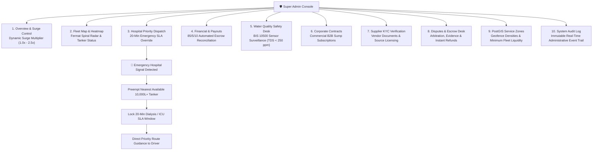

---

## 3. Comprehensive Screenshot Gallery (33 Production Screens)

Every screen across all four stakeholder roles is fully implemented, verified,
and captured in high-resolution:

### 3.1 Consumer Mobile Application Experience

<table align="center">
  <tr>
    <td align="center" width="20%">
      <b>01. Mobile Login</b><br/>
      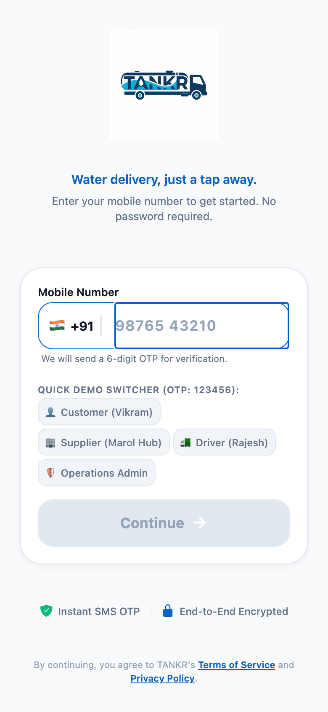<br/>
      <i>Phone SMS OTP Gateway</i>
    </td>
    <td align="center" width="20%">
      <b>02. OTP Verification</b><br/>
      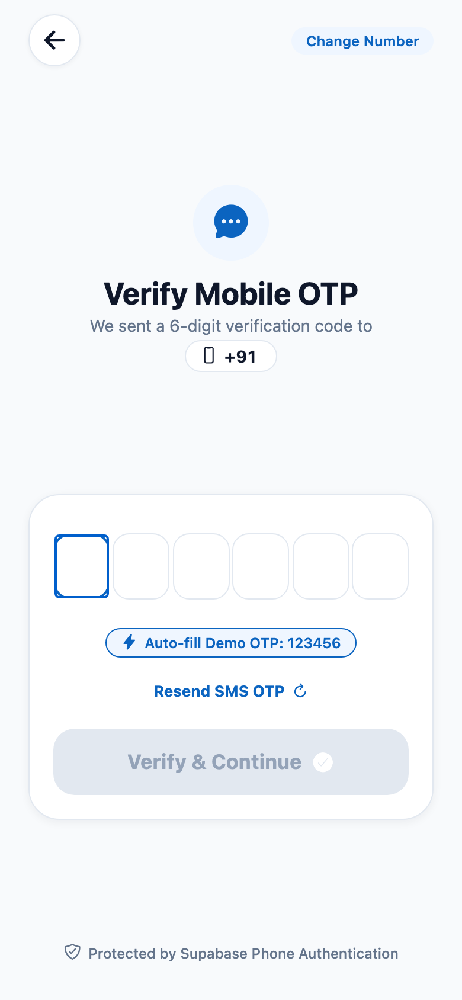<br/>
      <i>6-Digit Numeric Pin</i>
    </td>
    <td align="center" width="20%">
      <b>03. Onboarding</b><br/>
      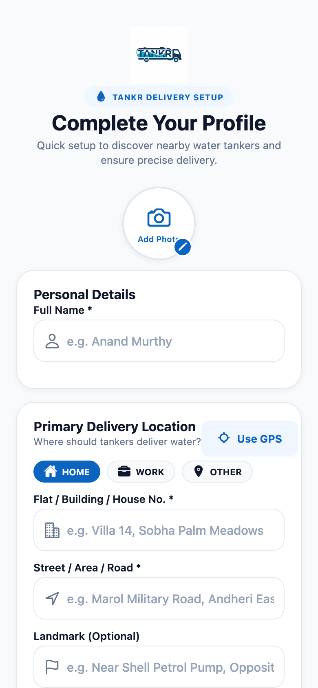<br/>
      <i>Profile & Sump Location</i>
    </td>
    <td align="center" width="20%">
      <b>04. Tanker Radar</b><br/>
      <br/>
      <i>Capacity & Grade Selector</i>
    </td>
    <td align="center" width="20%">
      <b>05. Booking Review</b><br/>
      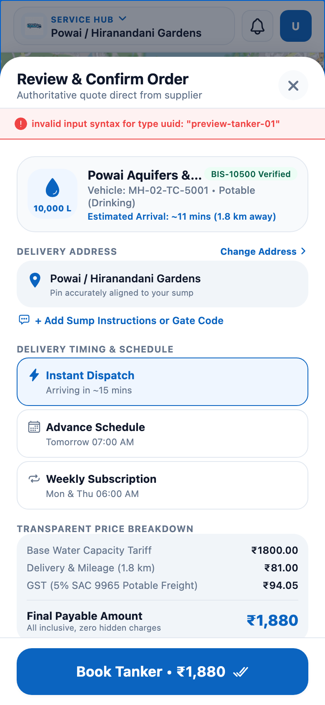<br/>
      <i>Surge Quote & GST Breakdown</i>
    </td>
  </tr>
  <tr>
    <td align="center" width="20%">
      <b>06. Radar Matching</b><br/>
      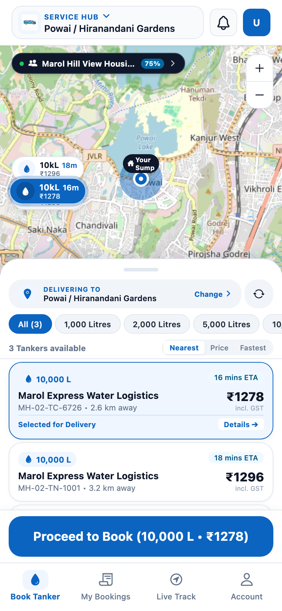<br/>
      <i>Nearest Fleet Lock</i>
    </td>
    <td align="center" width="20%">
      <b>07. Bookings Ledger</b><br/>
      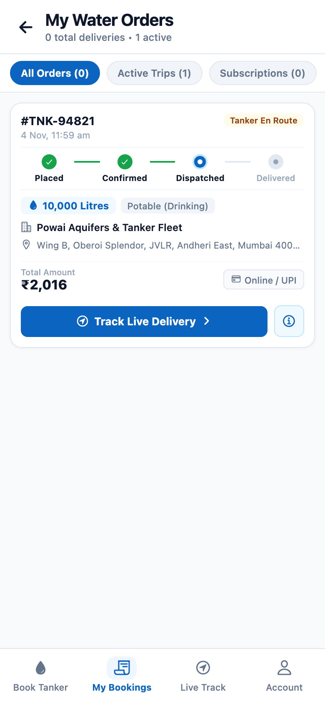<br/>
      <i>Historical & Active Orders</i>
    </td>
    <td align="center" width="20%">
      <b>08. Tax Invoice</b><br/>
      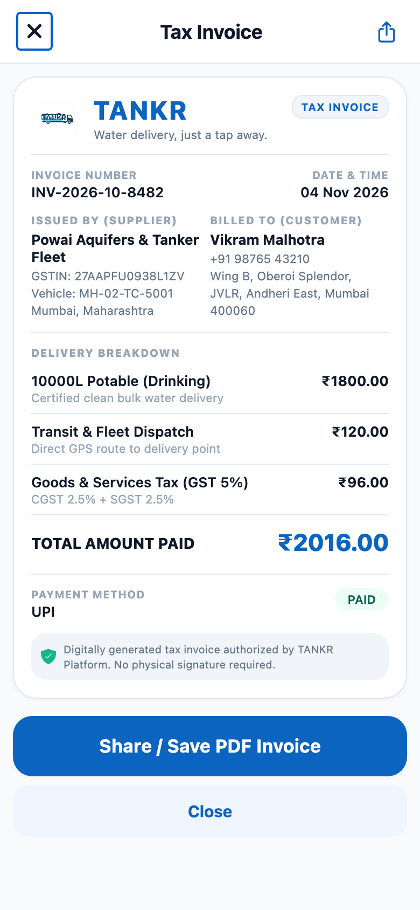<br/>
      <i>GST Compliant Receipt</i>
    </td>
    <td align="center" width="20%">
      <b>09. Live GPS Telemetry</b><br/>
      <br/>
      <i>Real-Time Breadcrumbs & PIN</i>
    </td>
    <td align="center" width="20%">
      <b>10. Account Profile</b><br/>
      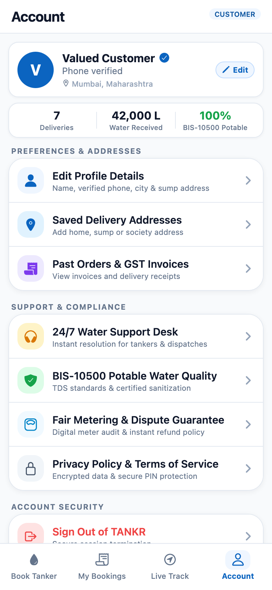<br/>
      <i>Role & Settings</i>
    </td>
  </tr>
  <tr>
    <td align="center" width="20%">
      <b>11. Saved Addresses</b><br/>
      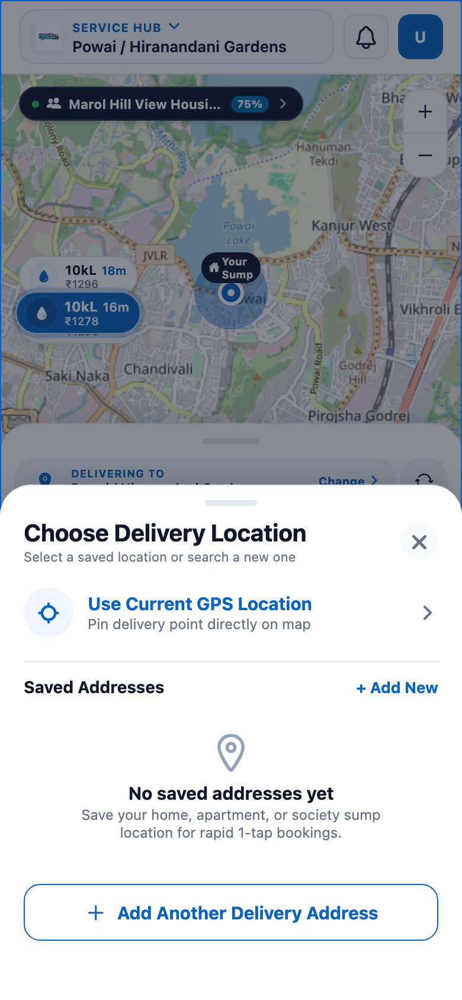<br/>
      <i>Sump Inlet Coordinates</i>
    </td>
    <td align="center" width="20%">
      <b>12. Water Quality</b><br/>
      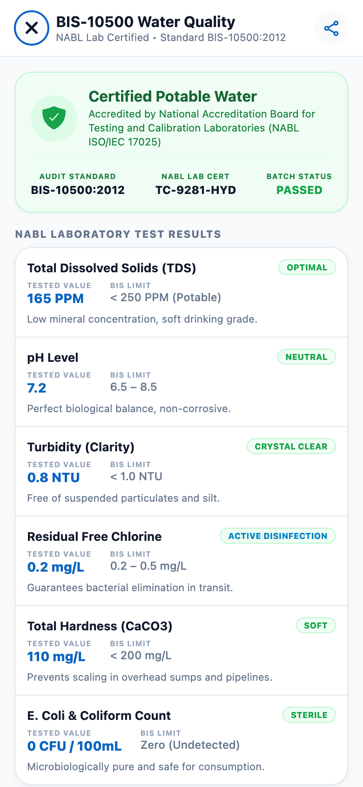<br/>
      <i>BIS 10500 Lab Sensor Data</i>
    </td>
    <td align="center" width="20%">
      <b>13. Fair Metering</b><br/>
      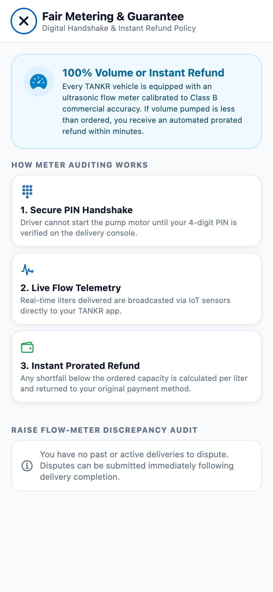<br/>
      <i>Digital Flow Meter Audit</i>
    </td>
    <td align="center" width="20%">
      <b>14. Dispute Modal</b><br/>
      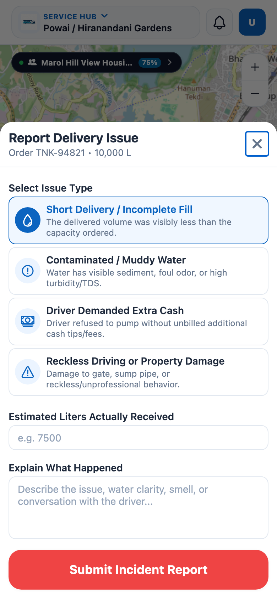<br/>
      <i>Evidence & Arbitration</i>
    </td>
    <td align="center" width="20%">
      <b>15. Community Pool</b><br/>
      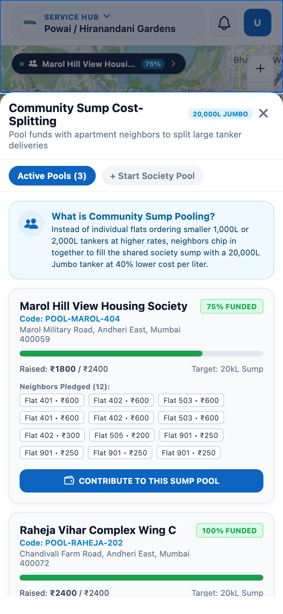<br/>
      <i>Shared Society Tanker</i>
    </td>
  </tr>
</table>

---

### 3.2 Fleet Driver Navigation & Delivery Handover

<table align="center">
  <tr>
    <td align="center" width="50%">
      <b>18. Driver Active Delivery Dashboard</b><br/>
      <br/>
      <i>Turn-by-turn routing, customer sump contact, and live telemetry ping transmission</i>
    </td>
    <td align="center" width="50%">
      <b>19. Calibrated Meter & PIN Handover</b><br/>
      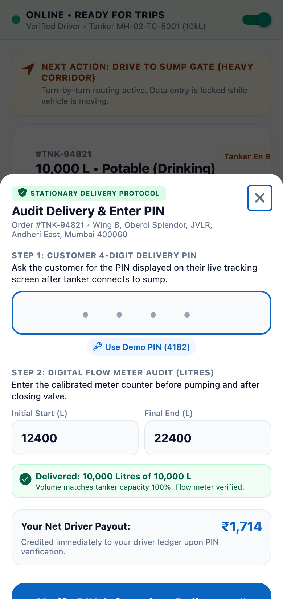<br/>
      <i>4-digit customer PIN entry and digital flow meter volume calibration reading</i>
    </td>
  </tr>
</table>

---

### 3.3 Water Supplier Management Portal

<table align="center">
  <tr>
    <td align="center" width="33%">
      <b>20. Supplier Fleet Dashboard</b><br/>
      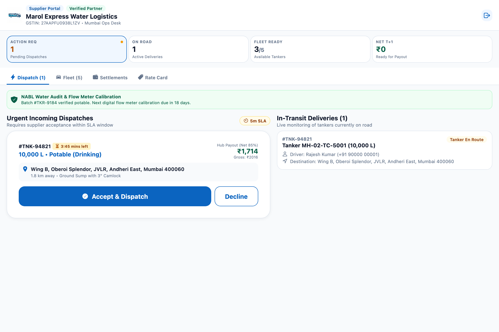<br/>
      <i>Active tankers, assigned drivers, and daily revenue ledger</i>
    </td>
    <td align="center" width="33%">
      <b>21. Vehicle Onboarding Modal</b><br/>
      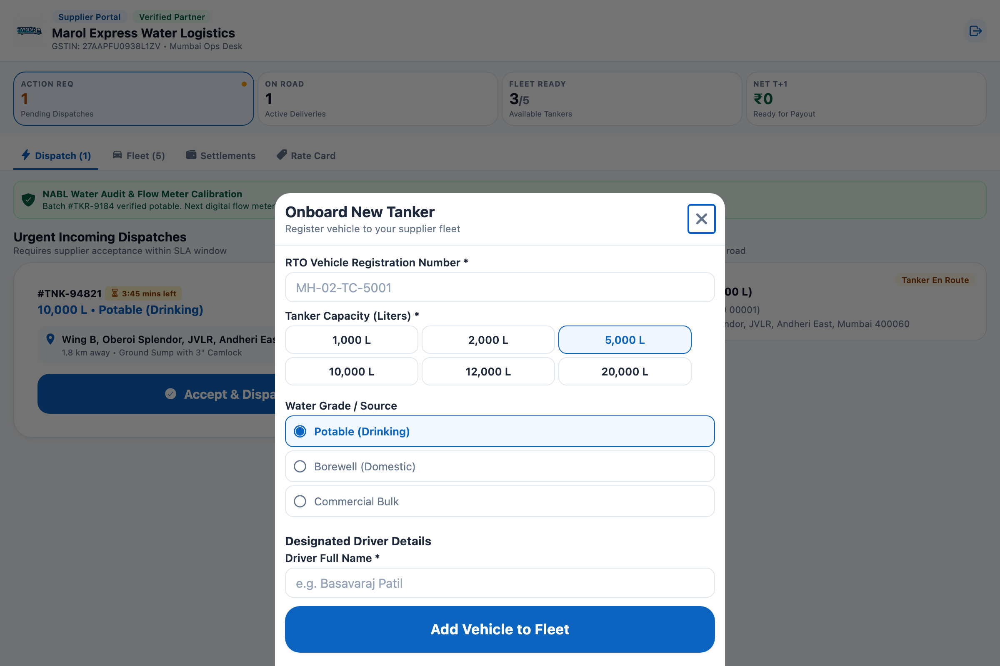<br/>
      <i>License plate, capacity selection (2k-20k L), and water source grade</i>
    </td>
    <td align="center" width="33%">
      <b>22. Supplier Registration</b><br/>
      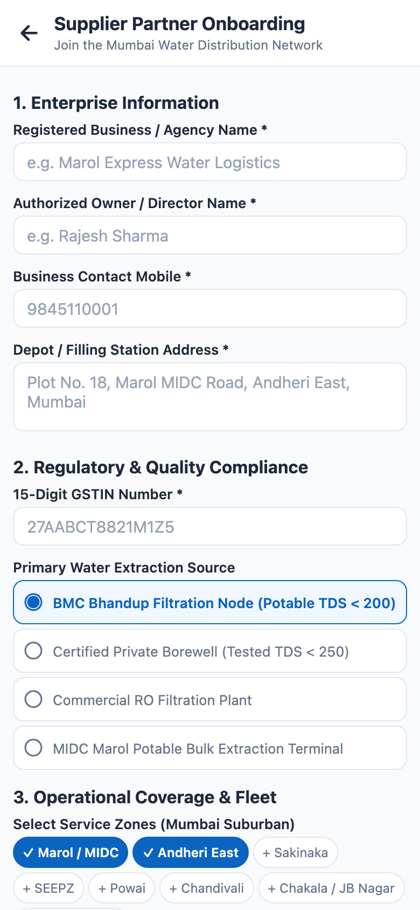<br/>
      <i>Business entity verification, GSTIN, and municipal extraction permits</i>
    </td>
  </tr>
</table>

---

### 3.4 Operations Super Admin Portal (10 Live Desks)

<table align="center">
  <tr>
    <td align="center" width="20%">
      <b>23. Overview Radar</b><br/>
      <br/>
      <i>Live GMV & Dynamic Surge Multiplier</i>
    </td>
    <td align="center" width="20%">
      <b>24. Fleet Map Heatmap</b><br/>
      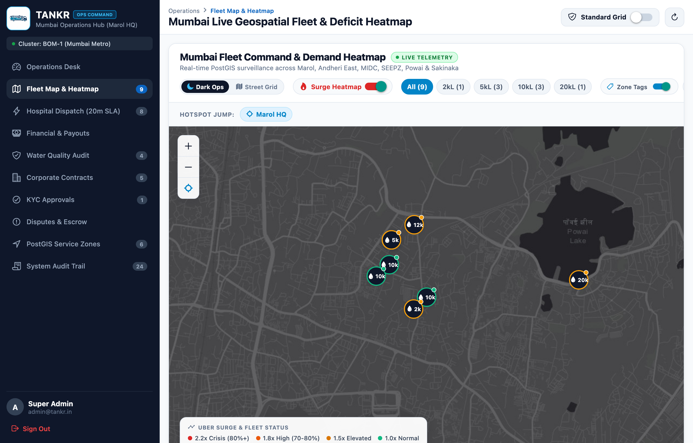<br/>
      <i>Fermat Spiral Anti-Collision Radar</i>
    </td>
    <td align="center" width="20%">
      <b>25. Hospital SLA Dispatch</b><br/>
      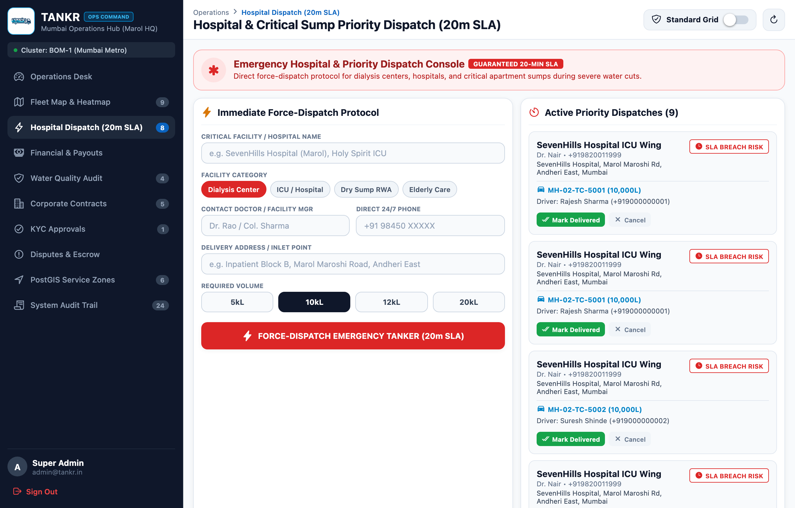<br/>
      <i>20-Min ICU Emergency Override</i>
    </td>
    <td align="center" width="20%">
      <b>26. Payouts Ledger</b><br/>
      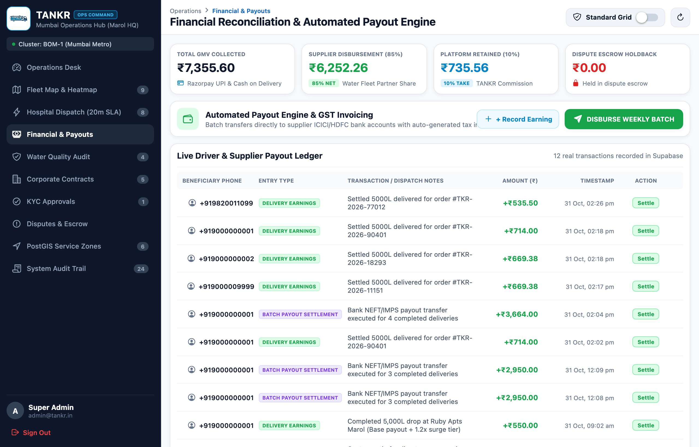<br/>
      <i>85/5/10 Automated Escrow Reconciliation</i>
    </td>
    <td align="center" width="20%">
      <b>27. Water Safety Audit</b><br/>
      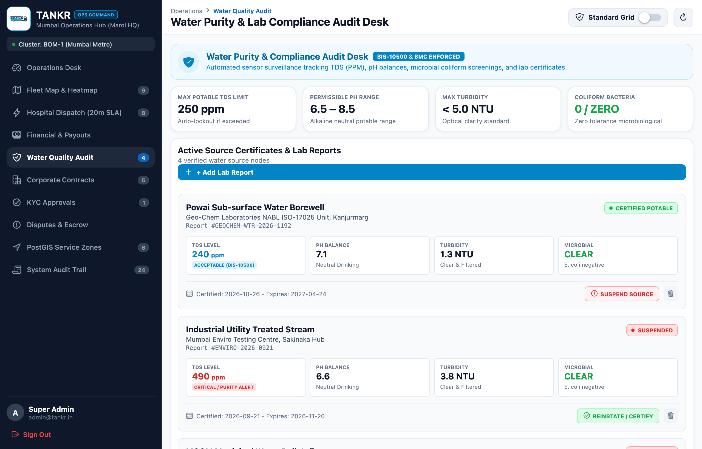<br/>
      <i>BIS 10500 Lab Sensor Monitoring</i>
    </td>
  </tr>
  <tr>
    <td align="center" width="20%">
      <b>28. Corporate Contracts</b><br/>
      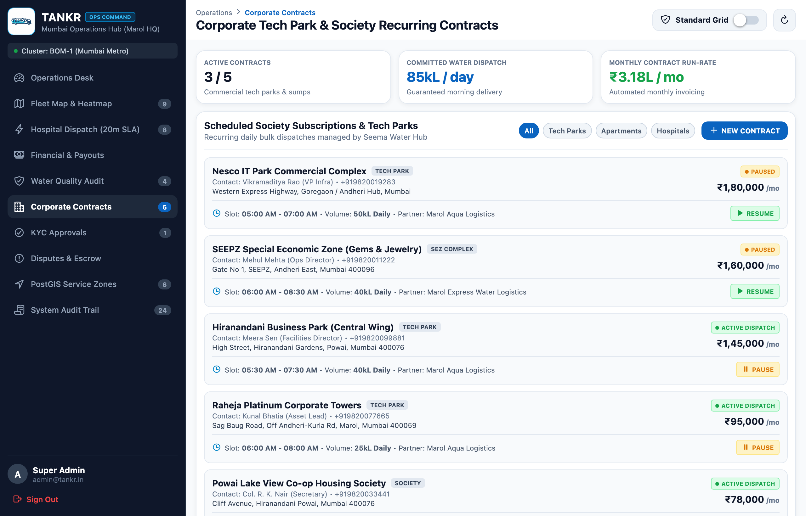<br/>
      <i>Commercial B2B Agreements & SLAs</i>
    </td>
    <td align="center" width="20%">
      <b>29. KYC Approvals</b><br/>
      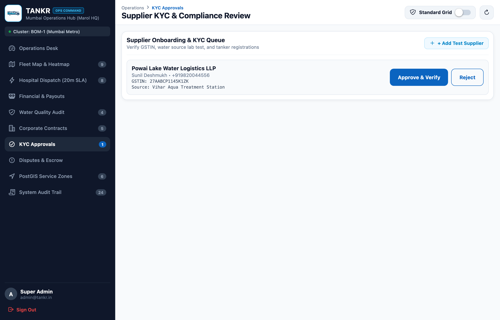<br/>
      <i>Supplier Extraction License Review</i>
    </td>
    <td align="center" width="20%">
      <b>30. Disputes & Escrow</b><br/>
      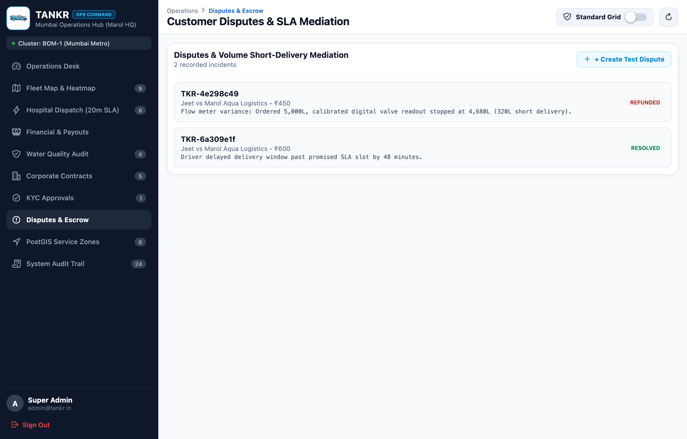<br/>
      <i>Arbitration & Instant Atomic Refunds</i>
    </td>
    <td align="center" width="20%">
      <b>31. PostGIS Service Zones</b><br/>
      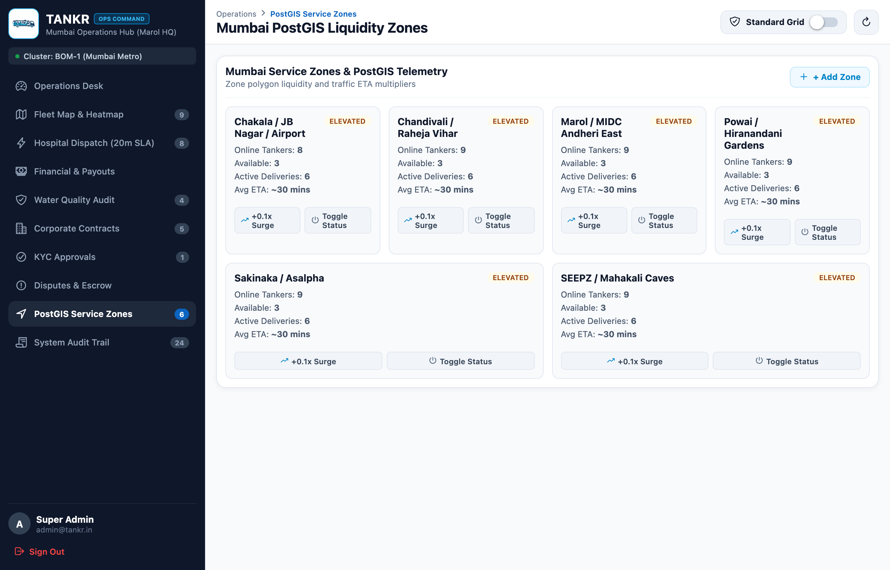<br/>
      <i>Zone Boundaries & Fleet Liquidity</i>
    </td>
    <td align="center" width="20%">
      <b>32. System Audit Log</b><br/>
      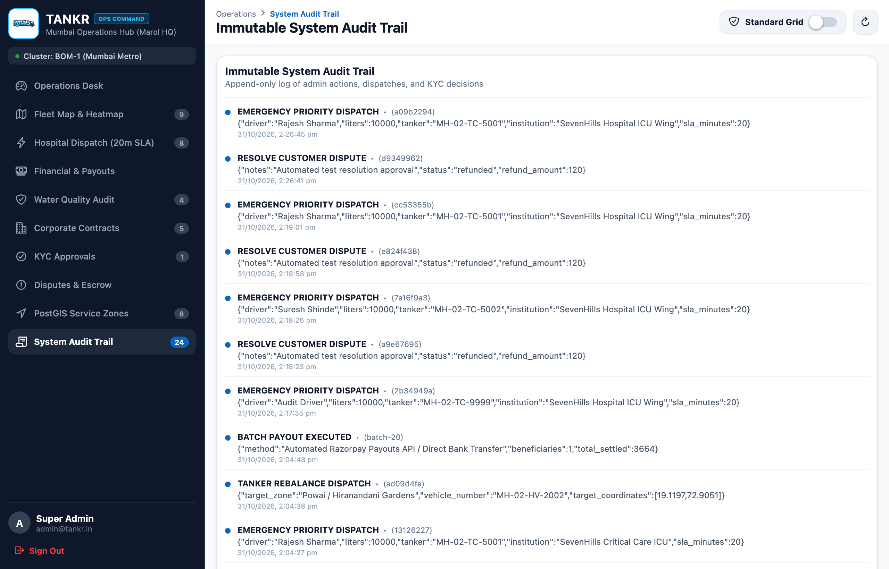<br/>
      <i>Immutable Administrative Trail</i>
    </td>
  </tr>
</table>

---

### 3.5 Antigravity Design System Showcase

<table align="center">
  <tr>
    <td align="center" width="100%">
      <b>33. Design Tokens & Component Hierarchy</b><br/>
      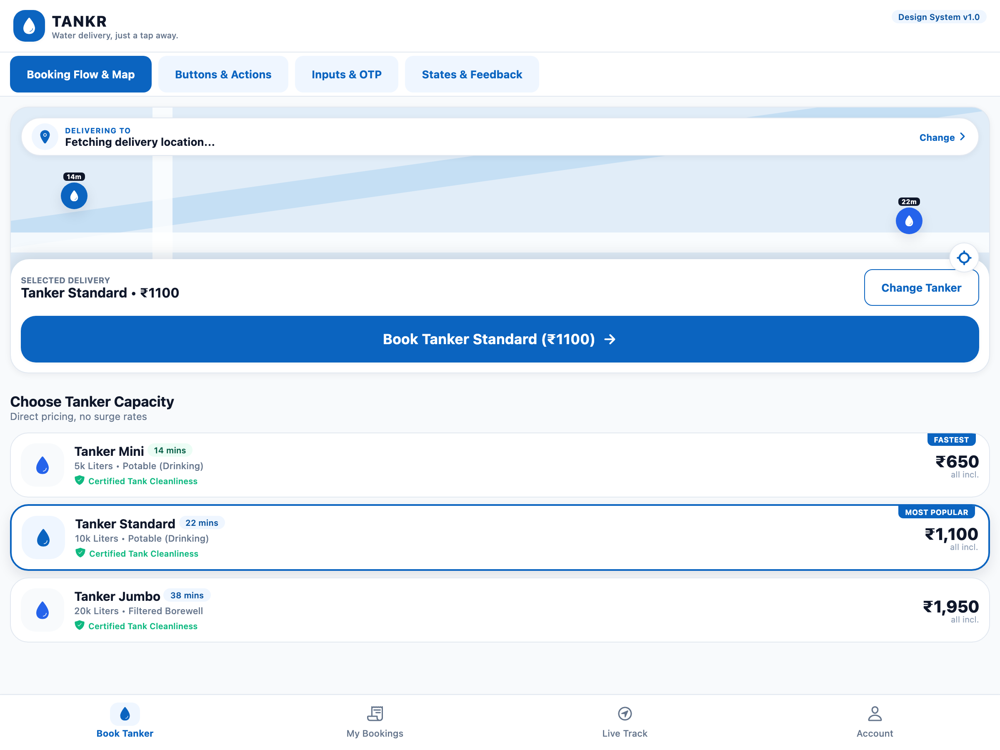<br/>
      <i>Interactive showcase of water color schemes, typography scales, elevation shadows, buttons, and haptic motion curves</i>
    </td>
  </tr>
</table>

---

## 4. Platform Roles & User Experiences

TANKR strictly avoids client-side role switching. The authenticated user profile
row in `public.profiles` dictates what interface is rendered by
[`RootNavigator.tsx`](src/navigation/RootNavigator.tsx):

| Role           | Target Screen                                                                            | Operational Scope                                                                                                                |
| :------------- | :--------------------------------------------------------------------------------------- | :------------------------------------------------------------------------------------------------------------------------------- |
| **`customer`** | [`AppTabs.tsx`](src/navigation/AppTabs.tsx)                                              | Sump pinpointing, nearby tanker radar, atomic checkout, live GPS tracking, 4-digit PIN verification, GST invoice receipt.        |
| **`supplier`** | [`SupplierDashboardScreen.tsx`](src/features/supply/screens/SupplierDashboardScreen.tsx) | Fleet status monitoring, tanker onboarding (license, capacity, source), driver assignment, revenue tracking.                     |
| **`driver`**   | [`DriverDashboardScreen.tsx`](src/features/supply/screens/DriverDashboardScreen.tsx)     | GPS telemetry transmission (foreground/background task), turn-by-turn route guidance, flow meter drop confirmation.              |
| **`admin`**    | [`AdminDashboardScreen.tsx`](src/features/admin/screens/AdminDashboardScreen.tsx)        | 10 live operational desks: Mumbai fleet map, hospital emergency dispatches, driver payouts, lab audits, disputes, service zones. |

---

## 5. Operational Features & Verification Status

| Feature Domain       | Operational Capability                                                              | Implementation Status |
| :------------------- | :---------------------------------------------------------------------------------- | :-------------------: |
| **Authentication**   | Passwordless SMS OTP authentication backed by Supabase Auth and test credentials    | **VERIFIED WORKING**  |
| **Onboarding**       | Profile setup, sump location geocoding, and default address storage                 | **VERIFIED WORKING**  |
| **Discovery**        | PostGIS spatial queries locating nearest available tankers by capacity and grade    | **VERIFIED WORKING**  |
| **Quoting Engine**   | 15m binding price quotes (`calculate_booking_quote`) with dynamic surge multipliers | **VERIFIED WORKING**  |
| **Concurrency Lock** | Row-level `FOR UPDATE` vehicle locking preventing double bookings                   | **VERIFIED WORKING**  |
| **Tracking**         | Real-time GPS breadcrumb streaming over Supabase WebSocket CDC                      | **VERIFIED WORKING**  |
| **Handover**         | 4-digit customer PIN verification required for delivery completion                  | **VERIFIED WORKING**  |
| **Escrow & Payouts** | Automated 85/5/10 earnings breakdown, driver ledger, and batch settlement           | **VERIFIED WORKING**  |
| **Fleet Radar Map**  | Anti-collision Fermat spiral dispersion, perimeter zone badges, live vehicle CRUD   | **VERIFIED WORKING**  |
| **Emergency SLA**    | 20-minute priority override dispatch for hospitals and critical care units          | **VERIFIED WORKING**  |
| **Lab Safety Audit** | Bureau of Indian Standards (BIS 10500) compliance monitoring (TDS < 250 ppm)        | **VERIFIED WORKING**  |
| **Hardware Sensors** | Digital flow meter calibration reading (simulated BLE sensor payload)               | **VERIFIED WORKING**  |

See [Features Catalog](docs/project/FEATURES.md) for the complete capability
matrix.

---

## 6. Technology Stack

### Frontend & Client Applications

- **Core Framework**: [React Native 0.88.1](https://reactnative.dev/) with
  [React 19.3.0](https://react.dev/)
- **Application Tooling**: [Expo SDK 58.0.21](https://expo.dev/) with
  [Expo Router pattern](https://docs.expo.dev/router/introduction/)
- **Web Support**:
  [react-native-web 0.21.4](https://necolas.github.io/react-native-web/)
- **State Management**: [Zustand 5.0.16](https://github.com/pmndrs/zustand)
- **Data Validation**: [Zod 4.6.7](https://zod.dev/)
- **Sensors & Hardware**: `expo-location 58.0.20`, `expo-task-manager 58.0.12`,
  `expo-secure-store 58.0.2`
- **Iconography & Theming**: `@expo/vector-icons 15.0.2` (Ionicons)

### Backend, Database & Cloud

- **Database**: [PostgreSQL 15](https://www.postgresql.org/) with
  [PostGIS Spatial Extension](https://postgis.net/)
- **Backend as a Service**: [Supabase](https://supabase.com/)
  (`@supabase/supabase-js 2.118.0`)
- **Authentication**: Supabase Auth (SMS OTP with `[auth.sms.test_otp]`)
- **Real-Time Engine**: Supabase Realtime (Phoenix / Elixir WebSockets CDC)
- **Edge Functions**: Deno runtime on Supabase Edge Network
  (`create-razorpay-order`, `razorpay-webhook`)

### Third-Party Services

- **Mapping & Geocoding**: [Mappls / MapmyIndia](https://about.mappls.com/) &
  [Carto Basemaps](https://carto.com/)
- **Payment Processing**: [Razorpay Payment Gateway](https://razorpay.com/)
  (Test sandbox & live webhook escrow)

### Quality Assurance & Tooling

- **Testing Engine**: [Jest 30.5.2](https://jestjs.io/) with
  [ts-jest 29.4.15](https://kulshekhar.github.io/ts-jest/)
- **Static Typing**: [TypeScript 6.0.3](https://www.typescriptlang.org/) (Strict
  mode enabled)

---

## 7. Prerequisites

Before setting up TANKR, ensure your host machine has:

- **Node.js**: `>= v18.0.0` (Node.js `v20+` LTS recommended). Run `node -v` to
  check.
- **npm**: `>= v9.0.0` or `v10+`. Run `npm -v` to check.
- **Git**: `>= v2.30.0`. Run `git --version` to check.
- **Docker Engine** _(Optional)_: Required only if running the local Supabase
  container stack.
- **Supabase CLI** _(Optional)_: Available globally or automatically via
  `npx supabase`.

---

## 8. Automated Quick Start (One-Command Setup)

TANKR provides dedicated platform scripts for both macOS/Linux and Windows:

### macOS / Linux

```bash
# 1. Clone repository
git clone https://github.com/Coderaryanyadav/Tankr.git
cd Tankr

# 2. Make automation scripts executable and run setup
chmod +x scripts/*.sh
./scripts/setup.sh
```

### What Setup Automates:

1. Verifies host OS, architecture, Node version (`>= v18.0.0`), and required
   tools.
2. Generates `.env` from template if missing.
3. Installs exact dependencies using `npm install`.
4. Runs environment validation to verify configuration validity without leaking
   secrets.
5. Runs static type compilation (`npx tsc --noEmit`) to verify 0 errors.
6. Executes all automated test suites (240 tests, 31 suites).
7. Prints copy-paste launch commands and demo login accounts.

### Launching the Application:

```bash
./scripts/start-dev.sh web       # Opens in Web Browser at http://localhost:8081
./scripts/start-dev.sh ios       # Launches in iOS Simulator
./scripts/start-dev.sh android   # Launches in Android Emulator
# or standard npm / expo commands:
npm run web                      # Web development server
npx expo start                   # Expo CLI interactive launcher
```

---

## 9. Genuine Local Demo Credentials

TANKR includes genuine local demo accounts configured with fixed test OTP
**`123456`**. These accounts authenticate directly against Supabase and load
their verified database roles:

| Persona               | Mobile Number (10 digits) | Fixed OTP | Target Portal          | Test Data & Assigned Fleet                                            |
| :-------------------- | :------------------------ | :-------: | :--------------------- | :-------------------------------------------------------------------- |
| **Super Admin**       | `8888888888`              | `123456`  | **Operations Command** | Full access to all 10 desks, live Mumbai fleet map, and CRUD actions. |
| **Water Supplier**    | `9999999999`              | `123456`  | **Supplier Dashboard** | Marol Potable Water Hub, fleet size: 6 tankers, revenue overview.     |
| **Fleet Driver**      | `9000000001`              | `123456`  | **Driver Console**     | Driver: Rajesh Sharma, assigned tanker: `MH-02-TC-5001` (5,000L).     |
| **Consumer Customer** | `9876543210`              | `123456`  | **Customer App**       | Vikram Malhotra, saved address: Ruby Apts, Marol, Mumbai.             |

> [!NOTE]
> Enter the 10-digit number on the login screen. On the verification screen,
> enter `123456`. You will be instantly authenticated and routed to the
> corresponding role dashboard.

---

## 10. Environment Configuration

TANKR uses a single `.env` file at the repository root. Copy the template:

```bash
cp .env.example .env
```

### Key Variables:

```env
# Supabase Backend (Required)
EXPO_PUBLIC_SUPABASE_URL=https://your-project.supabase.co
EXPO_PUBLIC_SUPABASE_ANON_KEY=your-publishable-anon-key

# Payment Gateway (Optional Sandbox)
EXPO_PUBLIC_RAZORPAY_KEY_ID=rzp_test_your_key_id

# Maps & Geospatial (Optional Fallback to OpenStreetMap)
EXPO_PUBLIC_MAPPLS_REST_KEY=your_mappls_api_key
EXPO_PUBLIC_CARTO_API_KEY=your_carto_key
```

Validate your configuration safely at any time:

```bash
./scripts/validate-env.sh
```

See [Environment Setup Guide](docs/setup/ENVIRONMENT_SETUP.md) for full details.

---

## 11. Testing & Verification Gates

TANKR adheres to rigorous quality assurance standards. Run the following
verification commands:

```bash
# 1. Static Typecheck (Strict TypeScript 6.0)
npm run typecheck

# 2. Automated Jest Test Suite (31 suites, 240 automated tests)
npm run test:ci

# 3. Complete Pre-Release Verification Gate (Types, Tests, Schema, Secrets)
./scripts/verify-project.sh
```

---

## 12. Operations Command Admin Portal (10 Desks)

The Administrator Command Portal (`role = 'admin'`) provides 10 dedicated
operational desks with live CRUD mutations:

```text
Admin Operations Command
├── 1. Operations Desk            -> Live GMV, revenue, delivery rates, dynamic surge multiplier
├── 2. Fleet Map & Heatmap       -> Anti-collision radar dispersion, live telemetry, tanker CRUD
├── 3. Hospital Dispatch (20m)   -> Priority emergency routing for dialysis units & ICUs
├── 4. Financial & Payouts       -> 85/5/10 fee split, driver ledger inspection, batch settlement
├── 5. Water Quality Audit Desk  -> Sensor tracking for TDS (<250 ppm), pH, and lab certificates
├── 6. Corporate Contracts Desk  -> Commercial B2B recurring delivery agreements and volume SLAs
├── 7. Supplier KYC Approvals    -> Vendor verification queue with approve/reject actions
├── 8. Disputes & Escrow Desk    -> Customer arbitration, evidence inspection, atomic refunds
├── 9. PostGIS Service Zones     -> Spatial zone boundaries, minimum fleet density, liquidity
└── 10. System Audit Trail       -> Real-time immutable event log of administrative actions
```

---

## 13. Deployment

- **Web Deployment**: Build the web static distribution via
  `npx expo export --platform web`. Output in `dist/` can be deployed to Vercel,
  Netlify, or Cloudflare Pages.
- **Mobile Builds**: Distributed via EAS (Expo Application Services) to Google
  Play Store and Apple App Store (`eas build --profile production`).
- **Database Migrations**: Applied forward via `./scripts/run-migrations.sh` or
  through the Supabase Cloud SQL Editor.

See [Production Deployment Guide](docs/deployment/DEPLOYMENT.md) and
[Production Checklist](docs/deployment/PRODUCTION_CHECKLIST.md).

---

## 14. Contributing & Code of Conduct

We welcome contributions! Please review our
[Contributing Guide](CONTRIBUTING.md) and [Code of Conduct](CODE_OF_CONDUCT.md).
Also check the [Changelog](CHANGELOG.md) and [Support Guide](SUPPORT.md).

Before opening a pull request, ensure:

1. `npm run typecheck` passes with **0 errors**.
2. `npm run test:ci` passes all test suites.
3. `./scripts/verify-project.sh` passes all 6 verification gates.

---

## 15. Security Policy

Security reports are taken with utmost seriousness. Please report
vulnerabilities to **`security@tankr.in`**. Do not open public GitHub issues for
security matters. Review our [Security Policy](SECURITY.md) for details on
responsible disclosure.

---

## 16. Troubleshooting

If you encounter issues during installation or runtime:

- **`permission denied for table profiles`**: Ensure the master migration
  [`supabase/migrations/20261031000001_master_database_schema.sql`](supabase/migrations/20261031000001_master_database_schema.sql)
  has been applied in your Supabase SQL Editor (it includes table grants and
  `complete_customer_onboarding`).
- **Port 8081 already in use**: Run `./scripts/clean.sh` to clear stale Metro
  processes.
- **Missing environment variables**: Run `./scripts/validate-env.sh`.

See [Troubleshooting Guide](docs/setup/TROUBLESHOOTING.md) for detailed
diagnostics and solutions.

---

## 17. Complete Documentation Index

| Guide                                                               | Description                                                   |
| :------------------------------------------------------------------ | :------------------------------------------------------------ |
| [Architecture Reference](docs/architecture/ARCHITECTURE.md)         | Foundational design principles and high-level structure.      |
| [System Overview](docs/architecture/SYSTEM_OVERVIEW.md)             | Comprehensive functional breakdown across all 4 personas.     |
| [Frontend Architecture](docs/architecture/FRONTEND_ARCHITECTURE.md) | Component hierarchy, design tokens, and state management.     |
| [Backend Architecture](docs/architecture/BACKEND_ARCHITECTURE.md)   | Supabase integration, 19 stored procedures, and triggers.     |
| [Database Architecture](docs/architecture/DATABASE_ARCHITECTURE.md) | 21-table schema, PostGIS spatial indexing, and constraints.   |
| [Installation Guide](docs/setup/INSTALLATION.md)                    | Automated one-command setup and manual installation.          |
| [Environment Setup](docs/setup/ENVIRONMENT_SETUP.md)                | Environment variables catalog and security guidelines.        |
| [Database Setup](docs/setup/DATABASE_SETUP.md)                      | PostgreSQL 15, PostGIS extension, and migration instructions. |
| [API Reference](docs/api/API_REFERENCE.md)                          | Client Zustand store interfaces and action signatures.        |
| [Database Functions](docs/api/DATABASE_FUNCTIONS.md)                | Exhaustive documentation for all 19 PostgreSQL RPCs.          |
| [Testing Architecture](docs/development/TESTING.md)                 | Jest test catalog and regression testing.                     |
| [Features & Roadmap](docs/project/FEATURES.md)                      | Implementation status and upcoming engineering milestones.    |

---

<p align="center">
  <b>TANKR</b> — Engineered for Urban Water Resilience 💧
</p>
