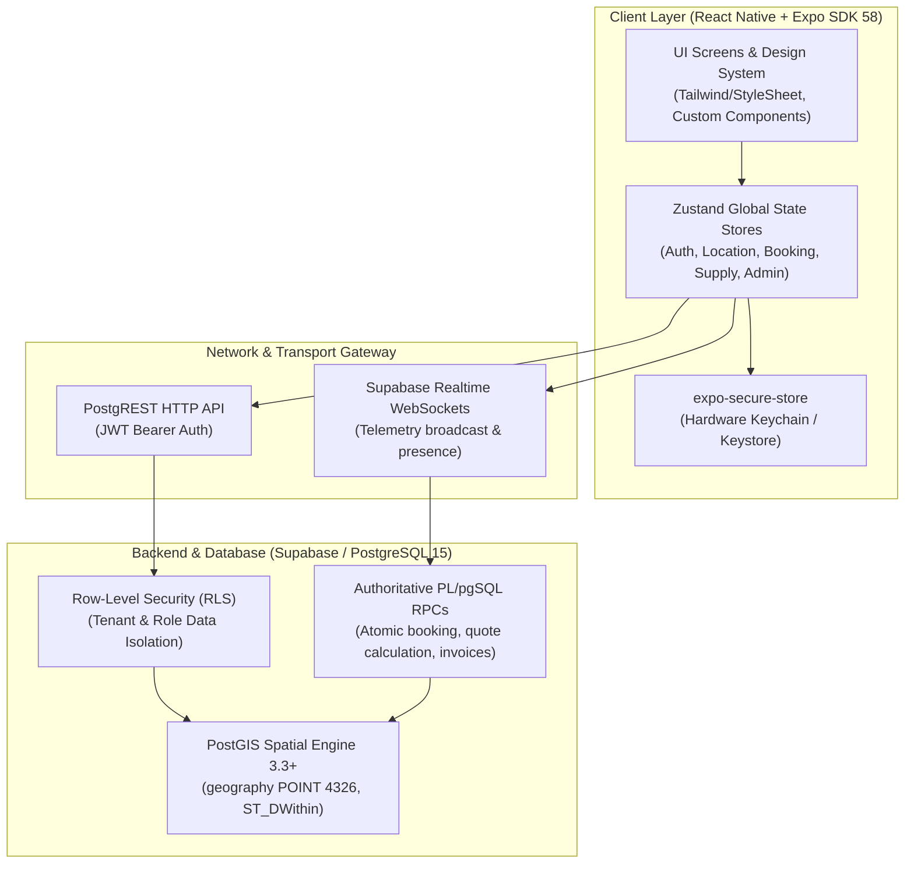
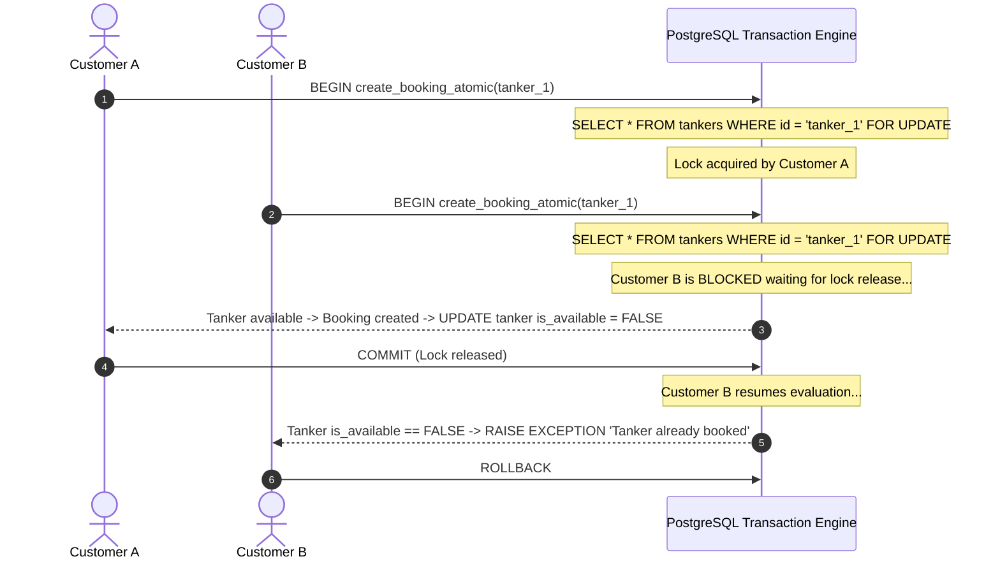
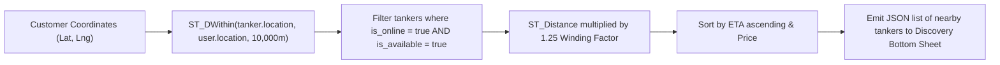
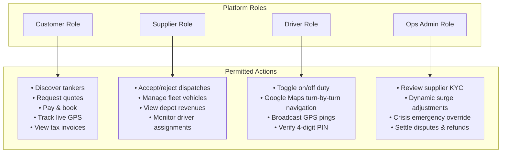

# TANKR — Architectural Blueprint & System Architecture

This document outlines the technical design, architectural layers, data pathways, and geospatial calculation pipelines of the TANKR mobile platform.

---

## 1. Multi-Tier System Architecture

---

## 2. Concurrency Control & Double-Booking Prevention

On-demand utility dispatch platforms encounter high contention during peak demand periods. Two users may attempt to reserve the same tanker simultaneously. TANKR uses pessimistic row locking inside the database engine:

---

## 3. PostGIS Spatial Discovery & Route Distance Estimation

When discovering nearby tankers, aerial straight-line distance (haversine) does not reflect actual road travel times in dense metropolitan traffic. TANKR calculates road travel distance using a 1.25 urban winding correction factor:

$$\text{Road Distance (km)} = \left(\frac{\text{ST\_Distance}(\text{tanker\_coord}, \text{user\_coord})}{1000}\right) \times 1.25$$

$$\text{Estimated Travel Time (minutes)} = \left(\frac{\text{Road Distance}}{\text{Urban Avg Speed (20 km/h)}}\right) \times 60 + \text{Depot Prep Time (5 mins)}$$

---

## 4. Multi-Role Permissions & Architectural Separation

