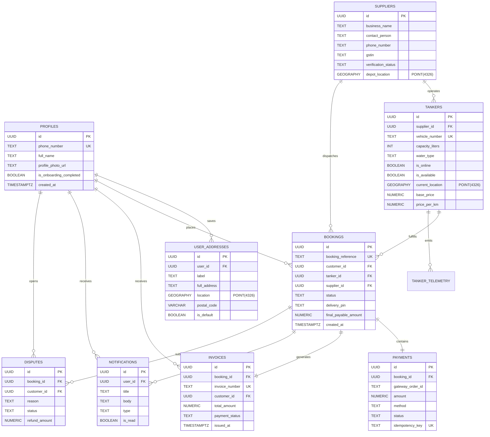

# TANKR — Database Schema & Data Dictionary

This document specifies the PostgreSQL 15+ relational schema, PostGIS spatial data types, indices, and server-side RPC functions.

---

## 1. Entity-Relationship Diagram

---

## 2. Server-Side RPC Functions Catalog

| Function Name | Return Type | Purpose |
| :--- | :--- | :--- |
| `get_nearby_tankers(lat, lng, radius_km)` | `TABLE(...)` | Executes PostGIS `ST_DWithin` and `ST_Distance` query to locate available tankers within radius. |
| `calculate_booking_quote(tanker_id, lat, lng)` | `TABLE(...)` | Authoritatively calculates base fare, distance charge, peak surcharge, and 5% GST. |
| `create_booking_atomic(tanker_id, ...)` | `TABLE(...)` | Atomically locks tanker row with `FOR UPDATE`, checks availability, and inserts booking with 4-digit PIN. |
| `cancel_booking_atomic(booking_id, reason)` | `BOOLEAN` | Cancels booking, releases tanker availability, and triggers refund record. |
| `supplier_accept_booking(booking_id, supplier_id)` | `BOOLEAN` | Supplier accepts incoming dispatch request and initiates driver assignment. |
| `driver_update_delivery_status(booking_id, status, pin)` | `BOOLEAN` | Advances delivery status (`en_route` ➔ `arrived` ➔ `delivered`), validating PIN on completion. |
| `record_driver_location_ping(booking_id, ...)` | `BOOLEAN` | Logs driver telemetry with velocity check (>100 km/h rejected) and updates current tanker coordinates. |
| `generate_invoice_for_booking(booking_id)` | `TABLE(...)` | Generates official tax invoice record and delivery completion notification. |
| `get_admin_dashboard_metrics()` | `TABLE(...)` | Aggregates Gross Merchandise Value (GMV), platform commission, fleet count, and water volume. |
| `admin_verify_supplier(supplier_id, status)` | `BOOLEAN` | Approves or rejects supplier KYC compliance status. |
