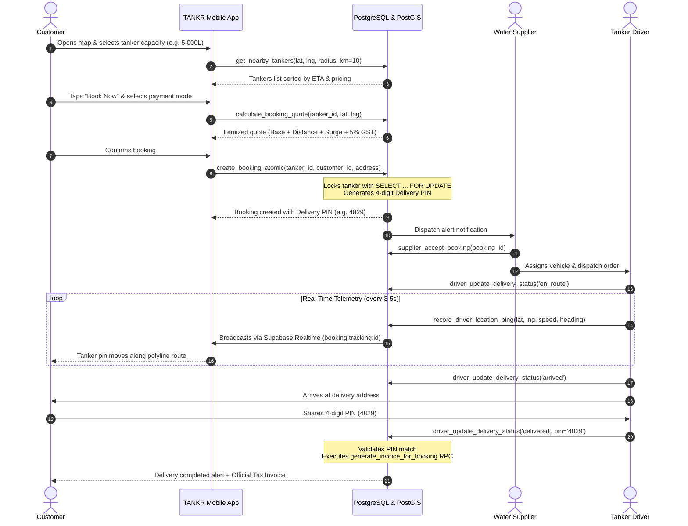
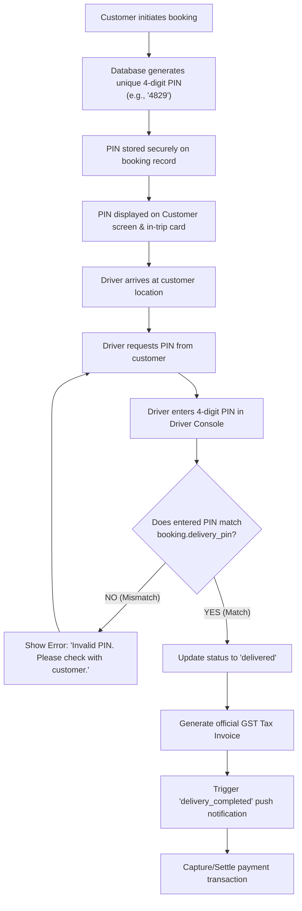
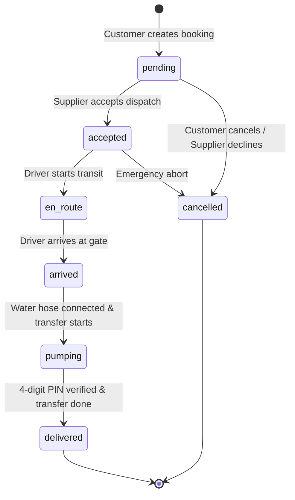
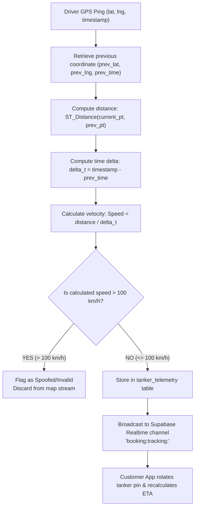
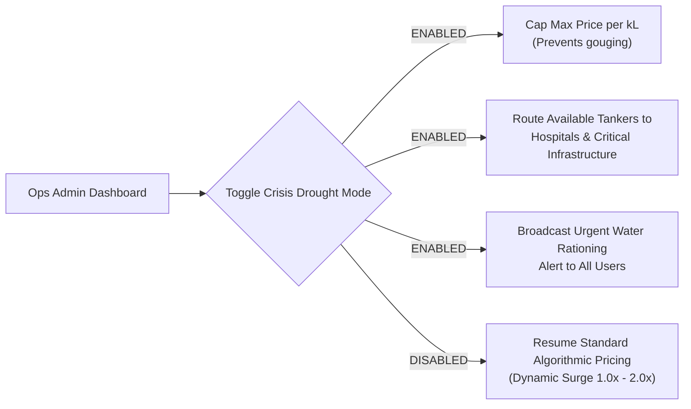

# TANKR — System Flow Diagrams & Lifecycle State Machines

This document provides visual flowcharts and sequence diagrams detailing every user journey and operational protocol within the TANKR ecosystem.

---

## 1. End-to-End Booking & Delivery Lifecycle

The interaction between Customer, Platform Engine, Tanker Supplier, and Driver follows an Uber/Ola-style dispatch loop:

---

## 2. 4-Digit Delivery PIN Verification State Machine

To prevent drivers from marking deliveries complete without physical water transfer, completion is guarded by a cryptographic PIN exchange:

---

## 3. Booking State Machine & Permitted Transitions

A booking must advance through strict, immutable state transitions:

---

## 4. Real-time Telemetry & Velocity Anti-Spoofing Filter

To prevent spoofed coordinates or unrealistic teleportation pings, every driver coordinate update passes through a spatial velocity filter:

---

## 5. Operations Command Center: Emergency Drought Protocol

In severe water shortage scenarios or civic emergencies, the platform enables priority routing and regulatory price controls:

