# 📚 TANKR Engineering Documentation Index

### _Technical Architecture, API Reference, Deployment & Operational Specifications_

 

**[🏠 Root README](../README.md)** &nbsp;•&nbsp;
**[📐 Architecture](#1-architecture-reference)** &nbsp;•&nbsp;
**[⚙️ Setup Guides](#2-setup--configuration-guides)** &nbsp;•&nbsp;
**[💻 Development](#3-development-standards)** &nbsp;•&nbsp;
**[📡 API Reference](#4-api--reference)** &nbsp;•&nbsp;
**[🚀 Deployment](#5-deployment--release)** &nbsp;•&nbsp;
**[📋 Project Specs](#6-project--community)**

---

## 🗺️ Documentation Architecture Map

```mermaid
flowchart TD
    Root["📚 TANKR Documentation Hub"]

    Root --> Arch["1. Architecture & Data Plane"]
    Root --> Setup["2. Setup & Configuration"]
    Root --> Dev["3. Development & Standards"]
    Root --> API["4. API & Stored Procedures"]
    Root --> Deploy["5. Deployment & Release"]
    Root --> Project["6. Project Specifications"]

    Arch --> A1["System Architecture"]
    Arch --> A2["Database ER & PostGIS"]
    Arch --> A3["Booking Lifecycle State Machine"]
    Arch --> A4["Security & RLS Matrix"]

    Setup --> S1["Automated Installation"]
    Setup --> S2["Environment Variables"]
    Setup --> S3["Supabase & Migrations"]
    Setup --> S4["Maps & Razorpay Setup"]

    Dev --> D1["Daily Workflow"]
    Dev --> D2["Zustand State Stores"]
    Dev --> D3["240 Jest Test Suites"]

    API --> P1["Client Store Actions"]
    API --> P2["19 PostgreSQL Definer RPCs"]
    API --> P3["Error Codes Catalog"]

    Deploy --> E1["Web SPA Hosting"]
    Deploy --> E2["Mobile EAS Builds"]
    Deploy --> E3["CI/CD Pipeline"]

    Project --> R1["30 Feature Inventory"]
    Project --> R2["Engineering Roadmap"]
    Project --> R3["Known Workarounds"]
```

---

## 📚 Documentation Directory

### 1. Architecture Reference

- [Architecture Overview](architecture/ARCHITECTURE.md): Foundational design
  principles and high-level structure.
- [System Overview](architecture/SYSTEM_OVERVIEW.md): Comprehensive functional
  breakdown across all 4 user personas.
- [Frontend Architecture](architecture/FRONTEND_ARCHITECTURE.md): Component
  hierarchy, theme system, state management, and navigation.
- [Backend Architecture](architecture/BACKEND_ARCHITECTURE.md): Supabase
  integration, RPC layer, triggers, and real-time pub/sub.
- [Database Architecture](architecture/DATABASE_ARCHITECTURE.md): 21-table
  schema, indexing, PostGIS spatial queries, and constraints.
- [Security Architecture](architecture/SECURITY_ARCHITECTURE.md): RLS policies,
  credential isolation, and audit logging.
- [Data Flow](architecture/DATA_FLOW.md): Step-by-step transaction paths from
  quote to delivery and payout.
- [Booking Lifecycle](architecture/BOOKING_LIFECYCLE.md): Exhaustive state
  machine and transition rules.
- **Architecture Diagrams**:
  - [System Architecture Diagram](architecture/diagrams/system-architecture.mmd)
  - [Database ER Diagram](architecture/diagrams/database-er.mmd)
  - [Booking Flow Diagram](architecture/diagrams/booking-flow.mmd)
  - [Authentication Flow Diagram](architecture/diagrams/authentication-flow.mmd)
  - [Payment Flow Diagram](architecture/diagrams/payment-flow.mmd)
  - [Tracking Flow Diagram](architecture/diagrams/tracking-flow.mmd)
  - [Deployment Architecture Diagram](architecture/diagrams/deployment-architecture.mmd)

---

### 2. Setup & Configuration Guides

- [Installation Guide](setup/INSTALLATION.md): Automated one-command setup and
  manual installation.
- [Environment Configuration](setup/ENVIRONMENT_SETUP.md): Environment variables
  catalog and security guidelines.
- [Database Setup](setup/DATABASE_SETUP.md): PostgreSQL 15, PostGIS extension,
  and migration instructions.
- [Supabase Setup](setup/SUPABASE_SETUP.md): Auth SMS OTP, Realtime CDC, and
  storage buckets.
- [Maps & Geospatial Setup](setup/MAPS_SETUP.md): Mappls and Carto basemap
  configuration.
- [Payment Gateway Setup](setup/PAYMENT_SETUP.md): Razorpay test sandbox and
  escrow flow.
- [Notifications Setup](setup/NOTIFICATIONS_SETUP.md): Push, in-app, and SMS
  notification triggers.
- [Troubleshooting Guide](setup/TROUBLESHOOTING.md): Solutions for common
  installation and runtime errors.

---

### 3. Development Standards

- [Development Guide](development/DEVELOPMENT_GUIDE.md): Daily development
  workflow and role testing.
- [Codebase Structure](development/PROJECT_STRUCTURE.md): Top-level directories
  and code organization.
- [Coding Standards](development/CODING_STANDARDS.md): TypeScript rules and
  React Native conventions.
- [State Management](development/STATE_MANAGEMENT.md): Zustand domain store
  breakdown.
- [API Integration](development/API_INTEGRATION.md): Supabase client and
  third-party service adapters.
- [Database Migrations](development/DATABASE_MIGRATIONS.md): Safe migration
  authoring and execution.
- [Testing Architecture](development/TESTING.md): Jest test catalog and
  regression testing.
- [Debugging Guide](development/DEBUGGING.md): Diagnostics for Metro, Web, and
  PostgreSQL.

---

### 4. API & Reference

- [Client API Reference](api/API_REFERENCE.md): Zustand store actions and
  interfaces.
- [Database Functions Reference](api/DATABASE_FUNCTIONS.md): Documentation for
  all 19 PostgreSQL stored procedures.
- [Error Codes](api/ERROR_CODES.md): Domain and PostgreSQL error definitions.

---

### 5. Deployment & Release

- [Deployment Guide](deployment/DEPLOYMENT.md): Web SPA hosting and mobile EAS
  builds.
- [Production Launch Checklist](deployment/PRODUCTION_CHECKLIST.md): Security
  and compliance verification gates.
- [Environment Matrix](deployment/ENVIRONMENT_VARIABLES.md): Dev, staging, and
  production variables.
- [CI/CD Pipeline](deployment/CI_CD.md): GitHub Actions automation reference.

---

### 6. Project & Community

- [Features & Implementation Status](project/FEATURES.md): Operational status of
  every platform capability.
- [Engineering Roadmap](project/ROADMAP.md): Upcoming hardware BLE flow meter
  and predictive deficit milestones.
- [Known Issues](project/KNOWN_ISSUES.md): Real-world limitations and verified
  workarounds.
- [Architectural Boundaries](project/LIMITATIONS.md): Geographical and capacity
  constraints.
- [Technical Glossary](project/GLOSSARY.md): Definitions of key domain and
  architectural terms.
