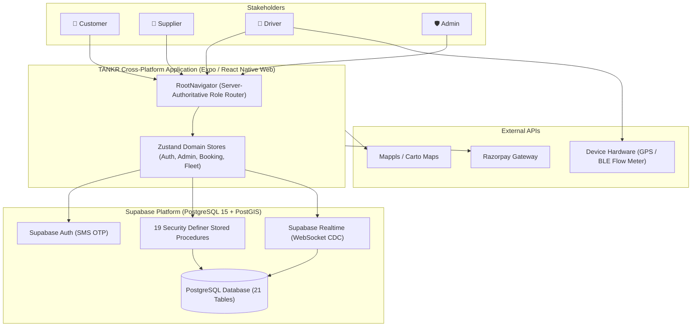

# TANKR — System Architecture Reference

## 1. Architectural Philosophy

TANKR is engineered as an on-demand water logistics and geospatial dispatch engine designed for metropolitan areas facing acute water deficit dynamics (specifically calibrated for Mumbai Metro — Marol, Sakinaka, SEEPZ, Powai, Chakala, and Chandivali).

The platform bridges consumer demand, decentralized private/municipal water suppliers, tanker vehicle fleets, and regulatory compliance authorities through a single, unified, cross-platform codebase.

---

## 2. Core Architectural Principles

1. **Server-Authoritative RBAC**:
   Permissions and role switching are strictly enforced at the PostgreSQL layer via Row-Level Security (RLS) policies and `SECURITY DEFINER` procedures. The client application (`RootNavigator.tsx`) routes users strictly based on the role stored in their verified database profile.
2. **Deterministic Pricing & Quoting**:
   Surge pricing, capacity tiers (2,000L, 5,000L, 10,000L, 20,000L), traffic multipliers, and tax calculations are computed via PostgreSQL stored procedures (`calculate_booking_quote`) with a 15-minute Time-To-Live (TTL) cryptographic quote expiration.
3. **Geospatial Real-Time Telemetry**:
   PostGIS coordinates (`geography(POINT, 4326)`) track driver locations with offline batch queues and WebSocket broadcast through Supabase Realtime CDC (Change Data Capture).
4. **Anti-Collision Fleet Radar**:
   To prevent map pin overlap at high-density depots, a golden-angle Fermat spiral algorithm mathematically offsets co-located vehicle tokens while preserving true geographic centroid queries.
5. **Defense-in-Depth Water Quality & Escalation**:
   Incorporates Bureau of Indian Standards (BIS 10500) potable compliance checks, automated hospital priority dispatch (20-minute SLA for dialysis centers and ICUs), and escrow-backed dispute arbitration.

---

## 3. High-Level Architecture Diagram

---

## 4. Key Subsystem Guides

- [System Overview](SYSTEM_OVERVIEW.md): Comprehensive functional breakdown across all 4 user personas.
- [Frontend Architecture](FRONTEND_ARCHITECTURE.md): Component hierarchy, theme system, state management, and navigation.
- [Backend Architecture](BACKEND_ARCHITECTURE.md): Supabase integration, RPC layer, triggers, and real-time pub/sub.
- [Database Architecture](DATABASE_ARCHITECTURE.md): 21-table schema, indexing, PostGIS spatial queries, and constraints.
- [Security Architecture](SECURITY_ARCHITECTURE.md): RLS policies, credential isolation, and audit logging.
- [Data Flow](DATA_FLOW.md): Step-by-step transaction paths from quote to delivery and payout.
- [Booking Lifecycle](BOOKING_LIFECYCLE.md): Exhaustive state machine and transition rules.
