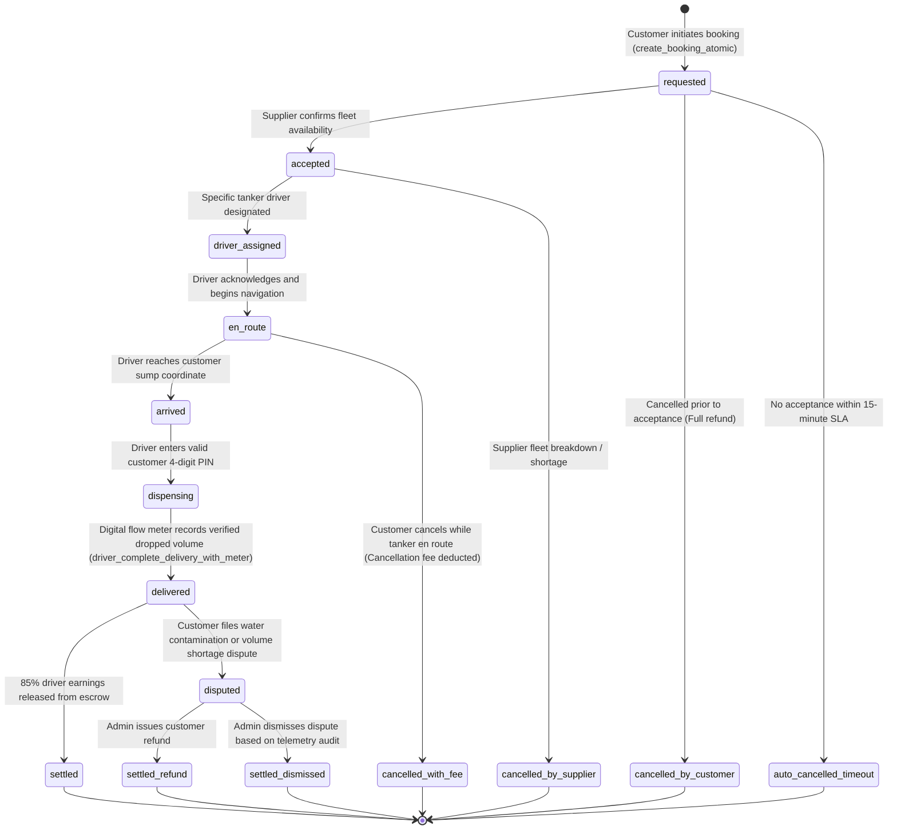

# TANKR — Booking Lifecycle & State Transitions

## 1. State Machine Definition

A water tanker delivery is a multi-step physical transaction governed by strict validation rules.

---

## 2. Cancellation Policy & Penalty Engine

Implemented in `customer_cancel_booking_with_policy()`:

| Phase | Timing | Penalty Applied | Refund Status |
| :--- | :--- | :--- | :--- |
| **`requested`** | Before supplier acceptance | ₹0 (No penalty) | 100% Instant Refund |
| **`accepted`** | Prior to vehicle dispatch | ₹0 (No penalty) | 100% Instant Refund |
| **`en_route`** | Vehicle dispatched (> 2km away) | ₹150 (Base mobilization fee) | Remaining balance refunded |
| **`arrived`** | Tanker on site at delivery sump | 50% of base fare | 50% refunded |
| **`dispensing`** | Valve opened / Pumping active | Cancellation locked | Non-cancellable |
