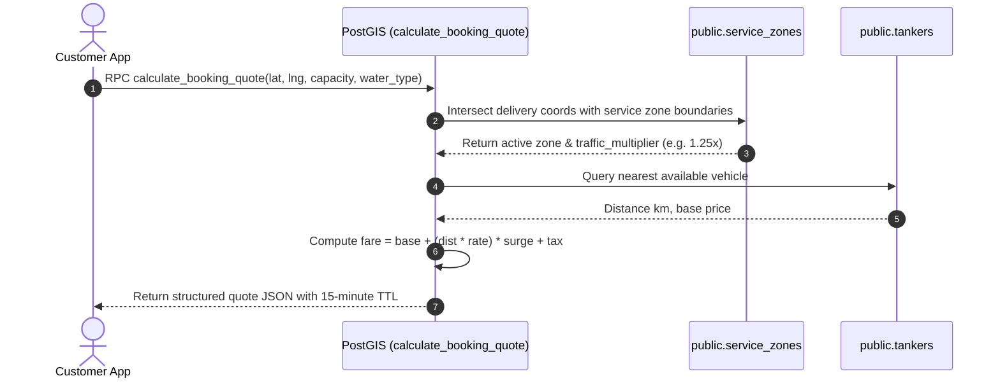
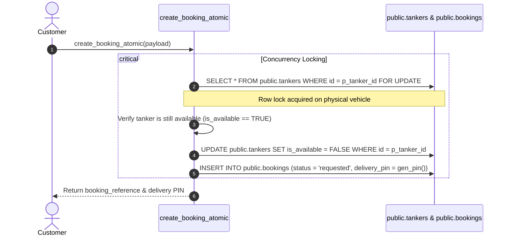
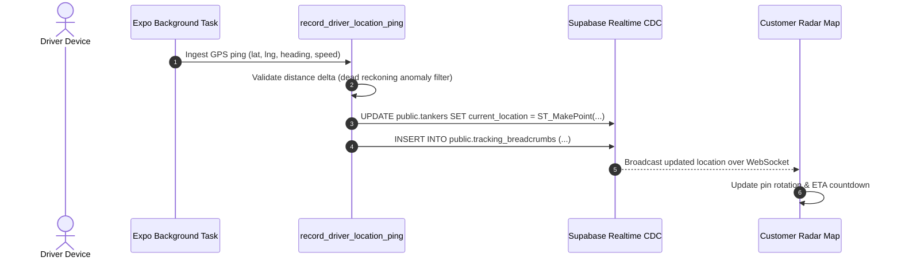

# TANKR — Data Flow Reference

This document traces the data trajectories across the system during key operational phases.

---

## 1. Discovery & Quoting Flow

---

## 2. Order Placement & Atomic Concurrency Lock

To prevent race conditions where two customers book the same physical tanker simultaneously:

---

## 3. High-Frequency Telemetry Ingestion

