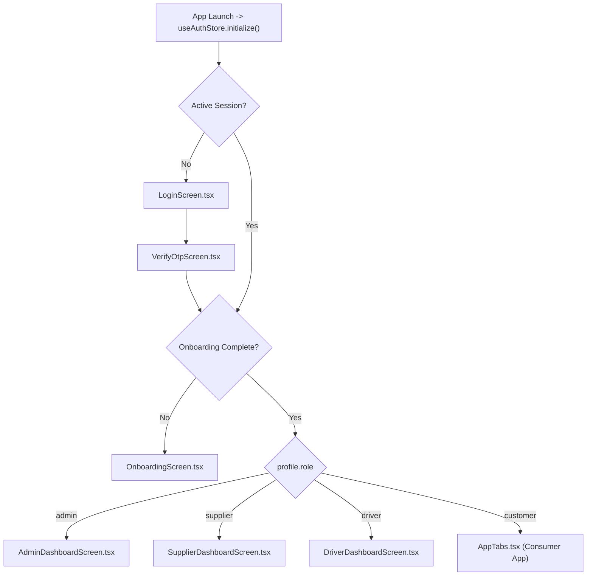

# TANKR — Frontend Architecture Reference

## 1. Overview & Technology Stack

The TANKR frontend is built using **React Native (0.88.1)** powered by **Expo SDK 58** and configured for cross-platform execution on iOS, Android, and modern Web browsers (`react-native-web 0.21.4`).

### Core Libraries & Dependencies:
- **Framework**: Expo ~58.0.21 (React 19.3.0, React Native 0.88.1).
- **State Management**: Zustand `^5.0.16`.
- **Validation**: Zod `^4.6.7`.
- **Geospatial & Hardware**: `expo-location`, `expo-task-manager`, `react-native-maps`.
- **Icons & Theme**: `@expo/vector-icons` (Ionicons).
- **Secure Persistence**: `expo-secure-store`.

---

## 2. Directory Hierarchy

```text
src/
├── components/          # Reusable design system UI components
│   └── common/
│       ├── Button/      # Primary, secondary, outline, danger buttons
│       ├── Card/        # Standard and elevated card containers
│       ├── Feedback/    # Alert banners, empty states, error boundaries
│       ├── Input/       # PhoneInput, FormTextInput, SearchBar
│       ├── Navigation/  # Header, tab bar, back buttons
│       └── Overlay/     # Modals, bottom sheets, full-screen loaders
├── features/            # Domain-driven feature modules
│   ├── admin/           # Super Admin portal & 10 operations desks
│   ├── auth/            # Phone login, OTP verification
│   ├── booking/         # Sump capacity selection, quote review, checkout
│   ├── community/       # Apartment pool sharing & bulk discounts
│   ├── discovery/       # Geospatial tanker radar & search
│   ├── disputes/        # Customer complaint filing & evidence upload
│   ├── location/        # Address management & reverse geocoding
│   ├── notifications/   # Push notification inbox & delivery alerts
│   ├── onboarding/      # Profile setup & delivery address onboarding
│   ├── orders/          # Active delivery tracking & order history
│   ├── profile/         # User preferences & account management
│   ├── supply/          # Supplier fleet manager & Driver consoles
│   └── tracking/        # Live GPS telemetry & route visualization
├── navigation/          # RootNavigator (role router) & AppTabs
├── services/            # External API adapters (Supabase, Mappls, Razorpay)
├── stores/              # Zustand domain state stores
├── theme/               # Design tokens (colors, typography, spacing, shadows)
├── types/               # TypeScript domain interfaces and schemas
└── utils/               # Formatting, error handling, alert utilities
```

---

## 3. Server-Authoritative Role Routing

Routing is managed through [`RootNavigator.tsx`](../../src/navigation/RootNavigator.tsx). The application never uses client-side flags to elevate roles.



---

## 4. State Management with Zustand

The application separates state into domain-focused stores:

| Store | Location | Responsibility |
| :--- | :--- | :--- |
| `useAuthStore` | [`src/stores/authStore.ts`](../../src/stores/authStore.ts) | Session management, SMS OTP auth, user profile, role resolution. |
| `useAdminStore` | [`src/stores/adminStore.ts`](../../src/stores/adminStore.ts) | Operations KPIs, live fleet telemetry, audit trail, CRUD mutations across all 10 desks. |
| `useLocationStore`| [`src/stores/locationStore.ts`](../../src/stores/locationStore.ts) | Active GPS coordinates, saved customer addresses, geocoding. |
| `useBookingStore` | [`src/stores/bookingStore.ts`](../../src/stores/bookingStore.ts) | Quote caching, selected capacity tier, checkout state. |
| `useTrackingStore`| [`src/stores/trackingStore.ts`](../../src/stores/trackingStore.ts) | Real-time vehicle coordinate streaming, ETA calculation, road snapping. |

---

## 5. Mobile-First & Cross-Platform Conventions

1. **Web Compatibility**:
   Web browser interactions use `Platform.OS === 'web'` branches to support standard browser dialogs (`window.confirm`), responsive container widths, and mouse drag/wheel interactions on maps.
2. **Strict Typography & Tokens**:
   All UI styling consumes design tokens defined in [`src/theme/`](../../src/theme/):
   - `colors.ts`: TANKR primary blue `#0A4D68`, water cyan `#088395`, surface cards, status badges.
   - `spacing.ts`: 4pt baseline grid (`xs: 4`, `sm: 8`, `md: 16`, `lg: 24`, `xl: 32`).
   - `typography.ts`: Mobile-optimized font scales and weight tokens.
