<div align="center">

# 🧪 TANKR Quality Engineering & Verification Framework

### _Deterministic Test Architecture, Concurrency Invariants & Multi-Role Verification_

[](../README.md#11-testing--verification-gates)
[](../README.md#11-testing--verification-gates)
[](https://www.typescriptlang.org/)
[](../README.md)

<br/>

**[🏠 Root README](../README.md)** &nbsp;•&nbsp;
**[🚀 Quick Start](#1-quick-start)** &nbsp;•&nbsp;
**[🗺️ Test Pipeline Flow](#-test-pipeline--quality-gates)** &nbsp;•&nbsp;
**[📁 Directory Structure](#2-directory-structure)** &nbsp;•&nbsp;
**[📊 Verification Matrix](#3-verification-matrix)**

</div>

---

## 🗺️ Test Pipeline & Quality Gates

```mermaid
flowchart TD
    Start["🧪 Developer / CI Trigger (`npm test`)"]

    subgraph Gate1["Gate 1: Preflight & Environment"]
        P1["validate-env.sh (.env Integrity)"]
        P2["Prerequisites & Node Version Check"]
    end

    subgraph Gate2["Gate 2: Static Typing & Contract Boundaries"]
        S1["TypeScript Strict Typecheck (`tsc --noEmit`)"]
        S2["Zod Schema Contract Validation (`qa/unit/validation/`)"]
        S3["Secret Leak Protection Scan (service_role rejection)"]
    end

    subgraph Gate3["Gate 3: Core Domain & Pricing Engine"]
        U1["Pricing Calculations & Surge Multiplier (`qa/unit/pricing/`)"]
        U2["Zustand Domain State Transitions (`qa/unit-tests/`)"]
        U3["Driver GPS Location Ping Buffer Queue (`gps_queue.test.ts`)"]
    end

    subgraph Gate4["Gate 4: Concurrency & Database Invariants"]
        C1["PostgreSQL Anti-Double-Booking Row Locks (`concurrency_and_race.test.ts`)"]
        C2["10-Way Contention Simulation (`property_based_fuzzing.test.ts`)"]
        C3["Database Foreign Keys & Invariants (`business_invariants.test.ts`)"]
    end

    subgraph Gate5["Gate 5: Security & Role Isolation"]
        R1["Row-Level Security Definer Policies (`security_and_rls.test.ts`)"]
        R2["Horizontal & Vertical Privilege Escalation (`rbac.test.ts`)"]
        R3["HMAC Payment Verification Invariants (`payments.test.ts`)"]
    end

    subgraph Gate6["Gate 6: Full E2E Scenarios & Release Gate"]
        E1["Full Order-to-Delivery Lifecycle (`booking_lifecycle.test.ts`)"]
        E2["Real-World Edge & Failure Regressions (`real_world_scenarios.test.ts`)"]
        E3["Two-Party PIN & Flow Meter Verification (`supplier_and_disputes.test.ts`)"]
    end

    Passed["✅ 240 / 240 Passed • 0 Failed • Ready for Deployment"]

    Start --> Gate1
    Gate1 --> Gate2
    Gate2 --> Gate3
    Gate3 --> Gate4
    Gate4 --> Gate5
    Gate5 --> Gate6
    Gate6 --> Passed
```



---

## 1. Quick Start

Run the entire automated test suite with a single command:

```bash
# Run all 31 test suites (240 tests)
npm test -- --watchAll=false
```

Individual test suites:

```bash
npm test -- qa/logic-tests/booking_state_machine_logic.test.ts    # State machine
npm test -- qa/security/critical_security_audit_remediation.test.ts # Security
npm test -- qa/unit/pricing/pricing_calculations.test.ts         # Pricing
npm test -- qa/performance/concurrency/concurrency_and_race.test.ts # Concurrency
npm test -- qa/e2e/full-lifecycle/real_world_scenarios.test.ts   # E2E scenarios
```

---

## 2. Directory Structure

```text
qa/
├── README.md                      # This verification guide
├── FEATURE_INVENTORY.md           # 30-feature traceability matrix
├── TEST_PLAN.md                   # Master quality strategy & release gates
├── TEST_MATRIX.md                 # Test case mapping across all layers
├── TEST_DATA_POLICY.md            # Synthetic data rules & safety guardrails
├── ENVIRONMENT.md                 # Test environment configuration
├── BUG_REPORT_TEMPLATE.md         # Standardized bug reporting format
│
├── unit/                          # Unit test suites (Pricing, Zod schemas)
├── unit-tests/                    # Core Zustand store & payment suites
├── logic/                         # Domain rule specifications & invariants
├── logic-tests/                   # Concurrency, state machine & matching tests
├── integration/                   # Integration suites (Booking, Driver, Payments)
├── security/                      # Security suites (RLS, RBAC, Secret scanning)
├── performance/                   # Concurrency suites (Race conditions, 10-way contention)
├── e2e/                           # End-to-end suites (20 Real-World scenarios)
├── accessibility/                 # Screen reader & usability verification
├── checkout/                      # Premium checkout conversion tests
├── map-first/                     # Map discovery & radar pinpointing tests
├── motion/                        # Micro-interactions & haptics feedback
├── regression/                    # Adversarial audit regression suites
├── supply/                        # Water supplier & driver management tests
├── tracking/                      # Live GPS telemetry & breadcrumb tests
└── scripts/                       # Executable test runner scripts
```

---

## 3. Verification Matrix

| Layer                    | Suites |  Tests  |      Status       | Invariants Enforced                                       |
| :----------------------- | :----: | :-----: | :---------------: | :-------------------------------------------------------- |
| **Static & Contracts**   |   2    |   24    |      `PASS`       | Strict TypeScript compilation, Zod input bounds           |
| **Unit & Pricing**       |   5    |   38    |      `PASS`       | Base fare, capacity tiers, dynamic surge multipliers      |
| **Concurrency & Logic**  |   8    |   62    |      `PASS`       | Anti-double-booking locks, 10-way race safety             |
| **Security & RLS**       |   4    |   36    |      `PASS`       | Cross-tenant isolation, privilege elevation triggers      |
| **Integration & Escrow** |   5    |   42    |      `PASS`       | Razorpay webhook verification, 85/5/10 payout split       |
| **E2E & Real-World**     |   7    |   38    |      `PASS`       | 4-digit PIN handover, flow meter attestation, offline GPS |
| **Total Test Suite**     | **31** | **240** | **`PASS (100%)`** | **0 Failures • Production Gate Approved**                 |
