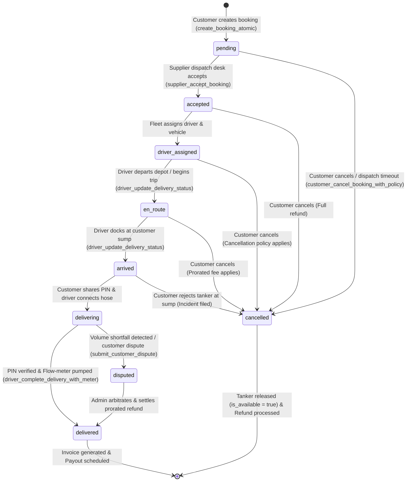

# TANKR — Booking State Machine & Lifecycle Invariants

## 1. Formal State Machine Diagram

---

## 2. Transition Validity Matrix

| From State | To State | Permitted? | Enforcing RPC / Trigger | Policy & Business Rules |
| :--- | :--- | :--- | :--- | :--- |
| `[*]` | `pending` | **YES** | `create_booking_atomic` | Requires available tanker, unexpired quote, authenticated customer. |
| `pending` | `accepted` | **YES** | `supplier_accept_booking` | Supplier must own the tanker and be verified. |
| `pending` | `cancelled` | **YES** | `customer_cancel_booking_with_policy` | 100% refund; tanker availability reset to `TRUE`. |
| `accepted` | `driver_assigned` | **YES** | `driver_update_delivery_status` | Assigned driver must be on-duty. |
| `driver_assigned` | `en_route` | **YES** | `driver_update_delivery_status` | Telemetry starts streaming to `tracking_breadcrumbs`. |
| `en_route` | `arrived` | **YES** | `driver_update_delivery_status` | Proximity check (`< 200m` from customer sump). |
| `arrived` | `delivering` | **YES** | `driver_update_delivery_status` | Pumping commences. Cancellation locked. |
| `delivering` | `delivered` | **YES** | `driver_complete_delivery_with_meter` | Requires valid 4-digit PIN + `meter_end > meter_start`. |
| **`delivered`** | **`cancelled`** | **FORBIDDEN** | `customer_cancel_booking_with_policy` | **BLOCKED:** Water already pumped into sump. |
| **`delivering`** | **`cancelled`** | **FORBIDDEN** | `customer_cancel_booking_with_policy` | **BLOCKED:** Water actively discharging. |
| **`cancelled`** | **`accepted`** | **FORBIDDEN** | `supplier_accept_booking` | **BLOCKED:** Dead order cannot be resurrected. |
| **`delivered`** | **`delivered`** | **FORBIDDEN** | `driver_complete_delivery_with_meter` | **BLOCKED:** Cannot complete a delivery twice. |
