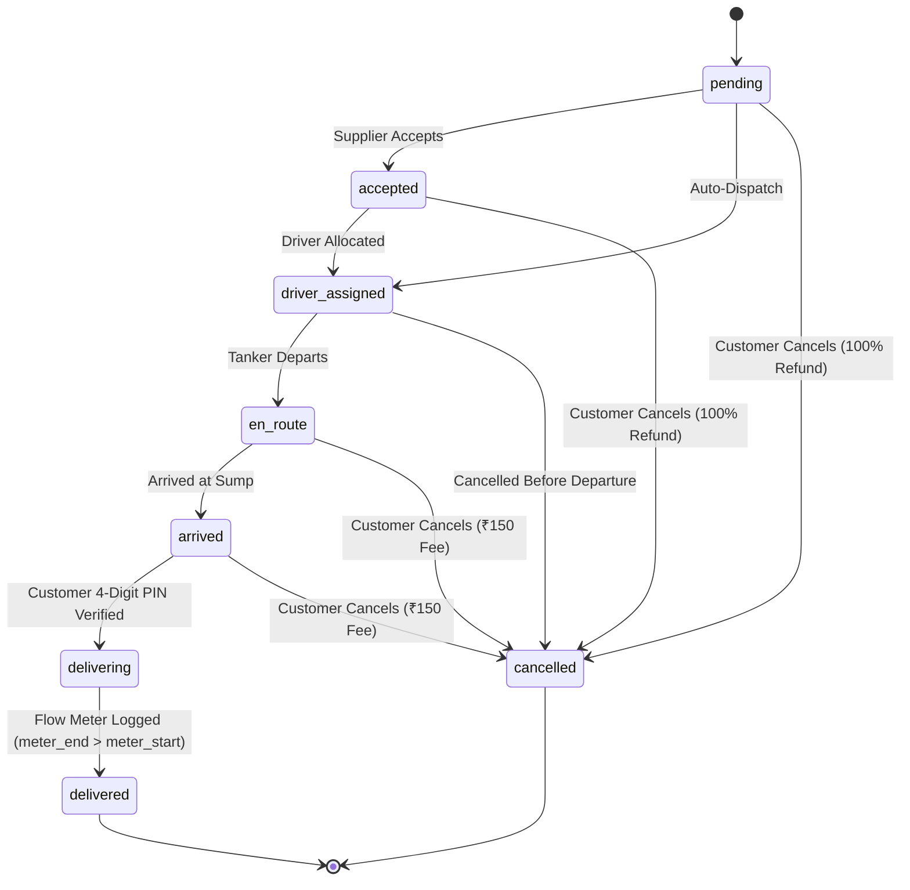

# TANKR — Booking State Machine Transition Report

## 1. Lifecycle State Machine Definition

The TANKR booking lifecycle consists of eight states:
1. `pending`: Booking placed; searching and connecting supplier.
2. `accepted`: Supplier accepted booking; tanker reserved.
3. `driver_assigned`: Dedicated driver allocated to tanker vehicle.
4. `en_route`: Tanker departed depot and en route to customer sump.
5. `arrived`: Tanker arrived outside destination premises.
6. `delivering`: PIN verified; water pumping in progress.
7. `delivered`: Meter readings recorded; terminal success state.
8. `cancelled`: Cancelled by customer or supplier; terminal termination state.

## 2. Transition Rules & Invariants Tested

- **Forward Transitions**: All 6 forward steps verified valid.
- **Illegal Backward Transitions**: `delivering` ➔ `pending`, `en_route` ➔ `accepted`, `arrived` ➔ `driver_assigned` strictly rejected.
- **Terminal States**: `delivered` and `cancelled` strictly reject any further transition (0 outgoing edges allowed).
- **Cancellation Policy**:
  - `pending`, `accepted`, `driver_assigned`: ₹0 fee, 100% refund.
  - `en_route`, `arrived`: ₹150 logistics driver compensation fee deducted.
  - `delivering`: Cancellation strictly rejected (water hose active).
  - `delivered`: Cancellation rejected (terminal delivery).
- **Verification Evidence**: [`qa/logic-tests/booking_state_machine_logic.test.ts`](file:///Users/aryan/Desktop/PROJECTS/TANKR/qa/logic-tests/booking_state_machine_logic.test.ts) (11 tests passed).
